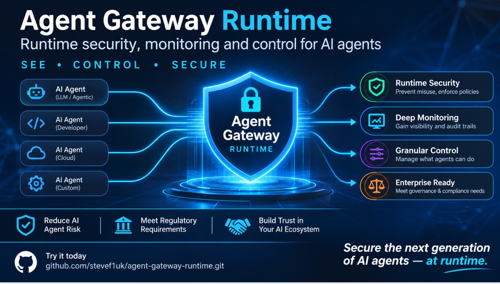

# Agent Gateway

## Fine-grained delegation. Human approval when it matters.

**Running Agent Gateway images?** See [how to verify image signatures and digests](docs/Container-Image-Security.md).

<p align="center">
  
</p>

AI agents are moving beyond chat. They can call APIs, use MCP servers, access enterprise systems, send emails, make payments and take actions on our behalf.

That creates a practical question:

> **How do you give an AI agent enough freedom to be useful without giving it unlimited authority?**

**Agent Gateway is the missing control layer for agent that actually do things.** 
Scoped authority • Automatic for low risk • Human approval for high stakes • Instant revocation • Full audit trail

Its defining capability is fine-grained delegation: a human scopes an agent's authority by what it can access and do, sets limits and expiry, and decides which actions require approval. The gateway checks each request against that authority, lets permitted work proceed, and holds consequential actions for a human decision.## Fine-grained delegation. Human approval when it matters.

**The agent gets scoped authority to work autonomously. People retain control over consequential actions.**

## The problem

When an agent can affect real systems, asking it to “be careful” is not a security control. Organisations need to know:

- Who authorised this agent to act?
- What is it allowed to do, and for how long?
- Which actions can happen automatically?
- Which actions need a human decision?
- How can access be stopped quickly?
- Can we show what happened afterwards?

Agent Gateway is designed to enforce those boundaries where an agent tries to use a tool, API or service.

## What does Agent Gateway do?

A human gives an agent a **fine-grained delegation**: what it may access and do, the applicable limits, and when its authority expires. The gateway checks each request against that authority and makes one of three decisions:

- **Allow** — the action is within the agent’s authority and can proceed.
- **Hold for approval** — the action waits for a human decision before it is executed.
- **Deny** — the agent is not authorised to perform the action.

Decisions are recorded for audit, and a delegation can be revoked so subsequent requests are refused—even if the agent still holds an otherwise valid token.

> **Agent Gateway lets AI agents work autonomously within human-defined boundaries, while keeping people in control of consequential actions.**

### Why not just use an existing API gateway, service mesh, or OPA sidecar?

Those tools are valuable infrastructure controls, and Agent Gateway is designed to complement—not replace—them. Agent Gateway adds fine-grained, human-issued delegation for autonomous agents, including time-bounded authority, approval workflows, and revocation. Read [the full explanation](docs/Why-Agent-Gateway.md).

## 📺 Watch the videos

A quick way to understand the project is to see it working:

| Video | What it covers |
|---|---|
| **Introduction to Agent Gateway (AGW)** | An introduction to AGW. [Watch on YouTube](https://youtu.be/yrPyAH-Jc6s) |
| **Quick Demo** | A short introduction to Agent Gateway and its core control model. [Watch on YouTube](https://youtu.be/0n9V7A_6KZg) |
| **Console Wizard Demo** | A walkthrough of the console and guided onboarding experience. [Watch on YouTube](https://youtu.be/eHiA4wtHUFk) |

## How it works

1. **A human defines the authority.** The delegation describes the resources and actions an agent may use, together with applicable limits and expiry.
2. **The agent gets to work.** Routine, authorised activity can proceed without asking a human to approve every request.
3. **The gateway checks each request.** It enforces the delegation and applicable policy at the point of access.
4. **Consequential actions can be held.** A human reviews the proposed action and approves or denies it before it reaches the protected system.
5. **Access can be revoked.** Operators can cut off a delegation without waiting for an agent token to expire.
6. **The activity is auditable.** Decisions and approval outcomes are recorded.

The goal is not to put a human in front of every agent action. It is to let routine work remain autonomous while keeping consequential decisions under human control.

## A practical example

Imagine an accounts-payable agent. It can read invoices, look up supplier records and prepare payments automatically. But when it proposes a significant payment, the gateway holds the action for a human decision.

The same pattern applies elsewhere: read data but require approval to delete it; prepare an email but require approval to send it; deploy to test automatically but hold production changes for review.

One of the project's demonstrations explores this under **prompt injection**. The important boundary is not whether the model recognises every malicious instruction: a consequential action is still subject to gateway enforcement and human approval.

## Try it yourself

The repository includes a local demonstration stack. Requirements are Docker Engine 24+ or Podman 4.7+, Compose, and `curl` (`jq` is optional). The short walkthrough below uses the signed, digest-pinned main images by default; the exact local image IDs used by STRIX and published-image verification steps are in the [image verification guide](docs/Container-Image-Security.md).

`./ensure-secrets.sh` creates the ignored `demo/.env` from `.env.example` if
it does not exist, generates independent local secrets, and restricts the
file to your user. You do not need to copy `.env` from another machine; do
not reuse a file containing machine-local image overrides or credentials.

```bash
cd demo
./ensure-secrets.sh
DEX_ISSUER_URL=http://dex:5556/dex \
OIDC_CONNECTOR_ID= \
WEB_ADMIN_EMAILS=alice@example.com \
docker compose up -d
./demo.sh
```

Then open the guided demo at [http://localhost:8083/demo.html](http://localhost:8083/demo.html).

The local demo signs in as `alice@example.com` with password `password`.
These shared credentials are intentionally insecure: use them only for a
loopback demo, never for production or security testing. For Google or
Microsoft Entra ID sign-in and the hardened setup, see the
[deployment guide](docs/Deployment-Guide.md#choose-an-authentication-mode).

The walkthrough covers sign-in, delegation, agent activity, a held action, a human decision, revocation and audit. For the full catalogue—including MCP protection, egress, DPoP/RAR, the kill switch, public API and Gmail examples—see **[the demos guide](docs/Demos.md)**.

To run the **OPA/Rego Policy Playground** together with the egress demo,
start Compose with both overlays from `demo/`:

```bash
DEX_ISSUER_URL=http://dex:5556/dex OIDC_CONNECTOR_ID= WEB_ADMIN_EMAILS=alice@example.com \
docker compose \
  -f docker-compose.yml -f docker-compose.egress.yml \
  -f docker-compose.opa.yml up -d
```

For Google/Microsoft sign-in, also include
`-f docker-compose.hardened.yml` so Compose keeps the generated IdP config.
For that external-IdP configuration, omit the local `DEX_ISSUER_URL` override:

```bash
docker compose -f docker-compose.yml -f docker-compose.egress.yml \
  -f docker-compose.opa.yml -f docker-compose.hardened.yml up -d
```

Then open [http://localhost:8083/policy.html](http://localhost:8083/policy.html).
The full overlay combinations and setup details are in the
[Demos guide](docs/Demos.md#running-the-demos).

In local Compose mode, the Console Wizard's `catalog-demo`, `users`, and `refunds` APIs are preconfigured to use JSONPlaceholder, and `geocoding` uses Open-Meteo Geocoding. Each runs behind a dedicated policy-enforcing gateway. Compose does not dynamically provision PEPs for arbitrary Wizard API URLs: unsupported API names or URLs are rejected rather than silently routed to the demo API. Set `CATALOG_DEMO_UPSTREAM_URL`, `USERS_API_UPSTREAM_URL`, `REFUNDS_API_UPSTREAM_URL`, or `GEOCODING_API_UPSTREAM_URL` before starting Compose to change those examples, or use Kubernetes mode for dynamically provisioned upstreams.

You can also explore the live CRM demonstration at [agw.sjfisher.com](https://agw.sjfisher.com) using the [Claude CRM tutorial](docs/Claude-CRM-Tutorial.md). See [Claude integration](docs/Claude-Integration.md) for the wiring details.

Agent Gateway has been successfully deployed on Kubernetes and on AWS, Google Cloud Platform (GCP) and Microsoft Azure. Provider-specific deployment configurations are available for running it on your own cloud infrastructure; see the [deployment guide](docs/Deployment-Guide.md).

## Use it with your own systems

Agent Gateway is designed to govern access to systems you already have, including:

- Internal and external APIs
- MCP servers and tools
- Agent egress
- Enterprise applications and existing agent runtimes

Choose a starting point:

- [Protect an API](docs/Protecting-Your-API.md)
- [Protect an MCP server](docs/Protecting-Your-MCP.md)
- [Agent authentication basics](docs/Agent-Auth-Basics.md)
- [Integration patterns](docs/Integration-Patterns.md)
- [Public API curl tutorial](docs/Public-API-Curl-Tutorial.md)

## Go deeper

- **[Common AI agent concerns](docs/Agent-Concerns.md)** — practical security and governance questions, and how Agent Gateway addresses them.
- **[Repository guide](docs/Repository-Guide.md)** — a directory of documentation, demo scripts and integration resources.

This README is the introduction. The technical detail lives in the supporting documentation:

- **[Architecture](docs/Architecture.md)** — components, request flow, enforcement and supporting services.
- **[Security model](docs/Security-Model.md)** — security properties, trust boundaries and threat considerations.
- **[Agent identity](docs/Agent-Identity.md)** — agent identity and delegated authority.
- **[DPoP and RAR](docs/DPoP-and-RAR.md)** — sender-constrained tokens and fine-grained permission downscoping.
- **[Policy and OPA](docs/Policy-and-OPA.md)** — policy-as-code and policy engine details.
- **[Why Agent Gateway?](docs/Why-Agent-Gateway.md)** — how it complements API gateways, service meshes and policy engines.
- **[Deployment guide](docs/Deployment-Guide.md)** — deployment and operational configuration.
- **[Observability](docs/Observability.md)** — logs, audit and tracing.

## Project status and feedback

> **Successfully deployed on Kubernetes, AWS, GCP and Azure — and continuing to evolve.**

The project is actively developed, with deployment experience across Kubernetes and the major cloud platforms. Feedback is still welcome: if you try the demos, integrate it with your own agent or have a different view of how agent authority should work, please [open an issue](https://github.com/stevef1uk/agent-gateway-runtime/issues) or get in touch at **steve@sjfisher.com**.

## Pricing and licensing

The project is free to explore, with a non-expiring licence token available to individuals by email request. Repository documentation and demo assets are MIT licensed; distributed software images are provided under a separate commercial licence. See [Pricing](docs/Pricing.md), [Commercial Licence](docs/Commercial-Licence.md) and [Security and Licensing](docs/Security-and-Licensing.md).

---

**The challenge isn't simply making AI agents autonomous. It's deciding where autonomy should end and human authority should begin.**

For the latest main image versions, verification details, and changes since
the previous release, see [RELEASE_NOTE.md](RELEASE_NOTE.md).
