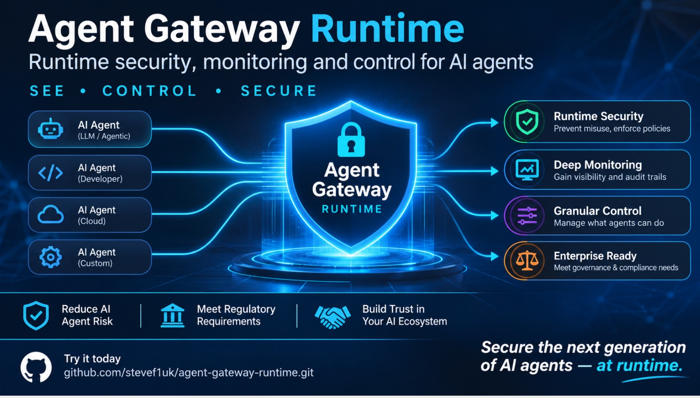

# Agent Gateway

## AI agents can act. Humans stay in control.

<p align="center">
  
</p>

AI agents are moving beyond chat. They can call APIs, use MCP servers, access enterprise systems, send emails, make payments and take actions on our behalf.

That creates a practical question:

> **How do you give an AI agent enough freedom to be useful without giving it unlimited authority?**

**Agent Gateway is a control layer between AI agents and the systems they can affect.** A human defines what an agent is allowed to do. The agent works autonomously within those boundaries. When an action needs a human decision—or falls outside those boundaries—the gateway intervenes.

**The agent gets to work. The human stays in control.**

## The problem

When an agent can affect real systems, asking it to “be careful” is not a security control. Organisations need to know:

- Who authorised this agent to act?
- What is it allowed to do, and for how long?
- Which actions can happen automatically?
- Which actions need a human decision?
- How can access be stopped quickly?
- Can we show what happened afterwards?

Agent Gateway is designed to enforce those boundaries where an agent tries to use a tool, API or service.

## What does Agent Gateway do?

A human gives an agent a **delegation**: a defined set of permissions, limits and an expiry. The gateway checks each request against that authority and makes one of three decisions:

- **Allow** — the action is within the agent’s authority and can proceed.
- **Hold for approval** — the action waits for a human decision before it is executed.
- **Deny** — the agent is not authorised to perform the action.

Decisions are recorded for audit, and a delegation can be revoked so subsequent requests are refused—even if the agent still holds an otherwise valid token.

> **Agent Gateway lets AI agents work autonomously within human-defined boundaries, while keeping people in control of consequential actions.**

## 📺 Watch the videos

A quick way to understand the project is to see it working:

| Video | What it covers |
|---|---|
| **Introduction to Managed Service** | An introduction to the managed-service proposition. [Watch on YouTube](https://youtu.be/qTvqpE9fqXM) |
| **Quick Demo** | A short introduction to Agent Gateway and its core control model. [Watch on YouTube](https://youtu.be/0n9V7A_6KZg) |
| **Console Wizard Demo** | A walkthrough of the console and guided onboarding experience. [Watch on YouTube](https://youtu.be/eHiA4wtHUFk) |

## How it works

1. **A human defines the authority.** The delegation describes the resources and actions an agent may use, together with applicable limits and expiry.
2. **The agent gets to work.** Routine, authorised activity can proceed without asking a human to approve every request.
3. **The gateway checks each request.** It enforces the delegation and applicable policy at the point of access.
4. **Consequential actions can be held.** A human reviews the proposed action and approves or denies it before it reaches the protected system.
5. **Access can be revoked.** Operators can cut off a delegation without waiting for an agent token to expire.
6. **The activity is auditable.** Decisions and approval outcomes are recorded.

The goal is not to put a human in front of every agent action. It is to let routine work remain autonomous while keeping consequential decisions under human control.

## A practical example

Imagine an accounts-payable agent. It can read invoices, look up supplier records and prepare payments automatically. But when it proposes a significant payment, the gateway holds the action for a human decision.

The same pattern applies elsewhere: read data but require approval to delete it; prepare an email but require approval to send it; deploy to test automatically but hold production changes for review.

One of the project's demonstrations explores this under **prompt injection**. The important boundary is not whether the model recognises every malicious instruction: a consequential action is still subject to gateway enforcement and human approval.

## Try it yourself

The repository includes a local demonstration stack. Requirements are Docker Engine 24+ or Podman 4.7+, Compose, and `curl` (`jq` is optional).

```bash
cd demo
docker compose up -d
./demo.sh
```

Then open the guided demo at [http://localhost:8083/demo.html](http://localhost:8083/demo.html).

The walkthrough covers sign-in, delegation, agent activity, a held action, a human decision, revocation and audit. For the full catalogue—including MCP protection, egress, DPoP/RAR, the kill switch, public API and Gmail examples—see **[the demos guide](docs/Demos.md)**.

You can also explore the live CRM demonstration at [agw.sjfisher.com](https://agw.sjfisher.com) using the [Claude CRM tutorial](docs/Claude-CRM-Tutorial.md). See [Claude integration](docs/Claude-Integration.md) for the wiring details.

Recently added are **aws** and **gcp** branches to this repository which provide the ability to host Agent Gateway on your own Cloud infrastructure.

## Use it with your own systems

Agent Gateway is designed to govern access to systems you already have, including:

- Internal and external APIs
- MCP servers and tools
- Agent egress
- Enterprise applications and existing agent runtimes

Choose a starting point:

- [Protect an API](docs/Protecting-Your-API.md)
- [Protect an MCP server](docs/Protecting-Your-MCP.md)
- [Agent authentication basics](docs/Agent-Auth-Basics.md)
- [Integration patterns](docs/Integration-Patterns.md)
- [Public API curl tutorial](docs/Public-API-Curl-Tutorial.md)

## Go deeper

- **[Common AI agent concerns](docs/Agent-Concerns.md)** — practical security and governance questions, and how Agent Gateway addresses them.
- **[Repository guide](docs/Repository-Guide.md)** — a directory of documentation, demo scripts and integration resources.

This README is the introduction. The technical detail lives in the supporting documentation:

- **[Architecture](docs/Architecture.md)** — components, request flow, enforcement and supporting services.
- **[Security model](docs/Security-Model.md)** — security properties, trust boundaries and threat considerations.
- **[Agent identity](docs/Agent-Identity.md)** — agent identity and delegated authority.
- **[DPoP and RAR](docs/DPoP-and-RAR.md)** — sender-constrained tokens and fine-grained permission downscoping.
- **[Policy and OPA](docs/Policy-and-OPA.md)** — policy-as-code and policy engine details.
- **[Deployment guide](docs/Deployment-Guide.md)** — deployment and operational configuration.
- **[Observability](docs/Observability.md)** — logs, audit and tracing.

## Project status and feedback

> 🚧 **Early preview — feedback helps shape the direction.**

Agent Gateway is published so people can run it, test the approach and help shape what comes next. If you try the demos, integrate it with your own agent or have a different view of how agent authority should work, please [open an issue](https://github.com/stevef1uk/agent-gateway-runtime/issues) or get in touch at **steve@sjfisher.com**.

## Pricing and licensing

The project is free to explore, with a non-expiring licence token available to individuals by email request. Repository documentation and demo assets are MIT licensed; distributed software images are provided under a separate commercial licence. See [Pricing](docs/Pricing.md), [Commercial Licence](docs/Commercial-Licence.md) and [Security and Licensing](docs/Security-and-Licensing.md).

---

**The challenge isn't simply making AI agents autonomous. It's deciding where autonomy should end and human authority should begin.**
