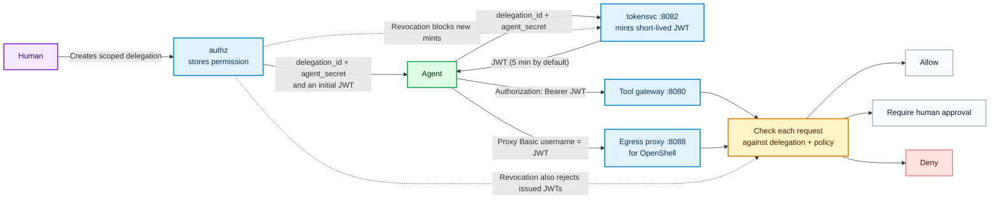

# How Agents Get a JWT — A Beginner's Guide

This page explains, in plain terms, the credential dance an AI agent
performs before it can talk to **Agent Gateway** (the tool gateway) or to
the gateway's **egress proxy** (used with NVIDIA OpenShell sandboxes). If
you already know the system, see [Architecture.md](Architecture.md) for
the deeper story.

For self-hosted AWS or GCP deployments, see the
[network placement guidance](Deployment-Guide.md#network-placement-and-cloud-edge-integration)
for integrating Agent Gateway with your existing edge, firewalls, and APIs.

## One-paragraph summary

A human grants a scoped **delegation**, and the agent receives a
`delegation_id`, an `agent_secret`, and an initial short-lived **JWT**. The
agent can exchange the ID and secret with **tokensvc** for fresh JWTs, then
present a JWT on each request to the **tool gateway** or, for OpenShell, the
**egress proxy**. Each request is checked against the delegation and policy:
it can be allowed, held for human approval, or denied. Revoking the
delegation prevents new tokens from being minted and causes already-issued
JWTs to be rejected by the gateway.

## The flow at a glance



## New here? The short version

1. **A human grants permission.** The human creates a scoped delegation:
   permission for a named agent to perform specified actions on specified
   resources, possibly with limits or approval requirements. authz returns a
   `delegation_id`, an `agent_secret`, and an initial short-lived JWT. The
   `delegation_id` identifies the grant; the `agent_secret` proves the agent
   is allowed to mint tokens for it. Deliver the secret to the agent securely:
   it is shown only when the delegation is created.
2. **The agent gets a temporary JWT.** When it needs a fresh token, it sends
   the `delegation_id` and `agent_secret` to tokensvc (`POST /token`, normally
   on port 8082). The default JWT lifetime is 5 minutes; the actual lifetime
   depends on the token request and deployment configuration.
3. **The agent presents the JWT on each request.**
   - For a tool/API call through the gateway, send it as
     `Authorization: Bearer <JWT>`.
   - For an OpenShell sandbox using the egress proxy, put the JWT in the
     username field of the proxy's Basic-auth file; OpenShell sends it as
     proxy credentials. The password field can be an arbitrary value.
4. **Each request is checked against the delegation and policy.** Depending
   on the request, the system allows it, holds it for human approval, or
   denies it.
5. **Renew or revoke.** When a JWT expires, the agent can mint another while
   the delegation remains active. If the human revokes the delegation,
   tokensvc will not mint more JWTs, and the gateway's revocation checks also
   reject JWTs that were already issued.

### Why does the JWT expire so quickly?

A Bearer JWT can be used by whoever holds it. Its short lifetime limits how
long a stolen JWT can be used: by default, it lasts 5 minutes (the requested
and configured lifetime can differ). When it expires, the agent does not need
a new human delegation; it asks tokensvc for another JWT using the same
`delegation_id` and `agent_secret`, as long as the delegation is still active.

Keep the `agent_secret` especially safe. Unlike an expired JWT, a stolen
`agent_secret` could be used to mint more JWTs while its delegation remains
active. Revoking the delegation stops new mints and causes already-issued
JWTs to be rejected by the gateway.

**Remember:** human grants scoped permission → agent receives a
`delegation_id` and `agent_secret` (plus an initial JWT) → agent exchanges
the ID and secret for short-lived JWTs → agent presents a JWT on each request.
The ID and secret are credentials for minting; the JWT is the temporary
credential presented to the gateway. Revocation ends the delegation even if
a JWT has not yet reached its expiry time.

## More advanced: bind tokens to a key and narrow their permissions

The standard flow above uses **Bearer JWTs**: anyone who obtains a bearer
token could try to present it until it expires or is revoked. Two optional
standards add further safeguards for integrations using the token service and
tool gateway:

- **DPoP** binds a token to a private key held by the agent. The agent proves
  possession of that key when presenting the token, so the token alone is not
  sufficient to use it.
- **RAR** lets the agent request a token with narrower permissions than the
  human's delegation, such as read-only access to `/orders`. The request must
  fit within the delegation, and the gateway continues to enforce the token's
  permissions along with the delegation's policy.

These can be used separately or together; they do not replace the human
delegation. The basic Bearer-token flow remains available. The OpenShell
Basic-auth setup described below uses the ordinary JWT flow, not DPoP.

See [DPoP and Rich Authorization Requests](DPoP-and-RAR.md) for the protocol
details and examples.

## The two credentials an agent receives

When the human grants a delegation (`POST /v1/delegations` on authz,
usually via the web console or a setup script), authz answers with **three**
things:

```json
{
  "delegation":   { "id": "del-abc123", "...": "..." },
  "token":        "eyJhbGciOi...",   // a ready-to-use JWT (see below)
  "agent_secret": "sec-9f3e..."      // the agent's own secret
}
```

- **`delegation_id`** (`del-abc123`) — identifies the grant. It is *not*
  secret by itself; you need something else to prove you are allowed to
  use it.
- **`agent_secret`** (`sec-9f3e...`) — the per-delegation secret. This is
  the credential you hand to the agent's operator/process once, at
  delegation time. authz stores only a hash, so nobody (not even the
  database) can reuse it.
- **`token`** — authz also mints one JWT immediately for convenience,
  but it has a short life. For anything longer, re-mint via tokensvc.

**Rule of thumb:** `delegation_id` + `agent_secret` are the *keys to the
mint*. The JWT is the *pass you carry* to the gateway.

### Where the ID token comes from (human side)

Before a delegation can be created on a tenant with SSO enabled, the
human (delegating user) must prove who they are with an OIDC ID token.
`POST /v1/delegations` on authz requires `"id_token": "<jwt>"`; authz
verifies it against the tenant's IdP (JWKS) and binds the delegation to
the token's `sub` claim.

On the local demo stack this happens automatically through Dex (the mock
connector needs no credentials), which is why `demo.sh` and
`kill-switch-demo.sh` sign you in transparently. On a remote tenant
(preprod, k3s, cloud) you obtain it yourself:

| Method | How |
|--------|-----|
| **Console session** | Sign in at the tenant console, open DevTools → Network, find the `POST` to the token endpoint (`/dex/token`, `/oauth/token`, …) whose response JSON contains `id_token`. Copy that JWT. |
| **OIDC auth-code flow** | Complete the authorization-code flow against the tenant's IdP and exchange the code for an ID token (see *Obtaining an ID token for a remote tenant* in [Demos.md](Demos.md)). |

Once you have the ID token, pass it in the delegation body (`"id_token"`) — or as `--id-token` / `ID_TOKEN=` when using `kill-switch-remote.sh` — and the delegation is bound to your verified subject. Any later call made with a delegation-scoped JWT is re-authorized against that subject's grant.

### How do I choose the agent's name / `agent_id`?

You choose it, or use a name from your agent framework. When creating a
delegation, provide an `agent_id` (sometimes called the agent name). It is a
human-readable string identifying the agent that receives the permission;
there is no central agent registry to consult first.

Examples:

- **LangChain / LangGraph:** use a name you assign to the agent, such as
  `research-agent` or `invoice-bot`.
- **CrewAI:** use the agent's role or a short ID you choose.
- **AutoGen, Semantic Kernel, LlamaIndex, or custom code:** choose a clear
  name such as `customer-support-agent` or `payment-agent-v1`.

Keep it short, lowercase, and descriptive. The same `agent_id` can be used
for multiple delegations, but separate names for distinct logical agents make
the console and audit trail easier to read. This value appears in the console,
audit records, and JWT claims. After creating the delegation, securely give
the agent process its `delegation_id` and `agent_secret`.

For example, the human includes it in the delegation-creation request to
authz (`POST /v1/delegations`):

```json
{
  "id_token": "<human's OIDC ID token>",
  "agent_id": "weather-tutorial-agent",
  "resources": ["/v1/forecast"],
  "actions": ["read"],
  "expires_in_seconds": 1800
}
```

The response contains the delegation ID and agent secret (and an initial
JWT). Later, the agent sends the `delegation_id` and `agent_secret` to
tokensvc to mint a JWT; it does **not** send `agent_id` again. The gateway
gets the agent identity from the JWT, so tool/API requests do not need an
`agent_id` field or header.

### What if I have multiple instances or a swarm?

If several instances share one delegation, they also share its `agent_id`,
permissions, limits, and revocation boundary. The audit trail identifies the
delegation and agent, but not which instance made a particular request.

For separate audit attribution, limits, or the ability to revoke one instance
without stopping the others, give each instance its own delegation, `agent_id`,
and `agent_secret`. For short-lived or dynamically created swarm workers, a
trusted provisioning service can create delegations for them. See
[Agent Identity](Agent-Identity.md#scaling--multiple-instances-shared-vs-per-instance-delegations)
for the trade-offs and scaling patterns.

## How the agent obtains a JWT

One HTTP call to the token service:

```bash
curl -s -X POST http://127.0.0.1:8082/token \
  -H 'Content-Type: application/json' \
  -d '{
    "delegation_id": "del-abc123",
    "agent_secret":  "sec-9f3e...",
    "ttl_seconds":   600
  }'
```

Response:

```json
{
  "access_token": "eyJhbGciOiJIUzI1NiJ9...",
  "token_type": "Bearer",
  "expires_in": 600,
  "delegation_id": "del-abc123"
}
```

What the token service does behind the scenes:

1. Looks up the delegation at authz; refuses when revoked or expired.
2. Verifies the `agent_secret` against the stored hash.
3. Mints a JWT signed with the shared `JWT_SECRET`, carrying
   `agent_id`, `user_id`, `delegation_id`, and the audience.
   Default TTL if you omit `ttl_seconds` is 5 minutes.

Frequent minting is normal and encouraged — the JWT is deliberately
short-lived. Re-mint whenever it expires (deal with 401 by minting a new
token, not by storing long-lived ones).

## Using the JWT against the tool gateway (:8080)

Attach the token on every call:

```bash
curl -s -X POST http://127.0.0.1:8080/v1/tools/... \
  -H "Authorization: Bearer $ACCESS_TOKEN" \
  -H 'X-Agent-Tool: purchase' \
  -H 'X-Agent-Resource: payments' \
  -H 'X-Agent-Action: create' \
  -d '{...}'
```

The gateway then resolves the token, checks revocation, and asks authz
for a per-call decision:

- **Allow** → forwarded to the upstream service, audited.
- **Approval required** → you get `202` + `approval_id`; a human must
  approve (web console / Telegram / webhook) before the call proceeds.
- **Deny** → `403` + reason, audited.

Any language works — it is plain HTTP: POST to `:8082/token` for the
mint, then the request above with the Bearer header. Wire a re-mint on
the next `401` and you have the whole client.

## OpenShell sandboxes and the egress proxy (:8088)

The OpenShell case works differently on the surface, but it is **the
same credential and the same mint**. OpenShell's supervisor can only
present a classic HTTP-proxy Basic password — it cannot mint tokens. So
you mint the token elsewhere and give it to the supervisor as the
*username* of one Basic credential:

1. **Create a delegation** allowing (for example) OpenRouter traffic,
   and hold dangerous actions (`connect`, `delete`) for human approval.
2. **Mint a token** from delegations as above.
3. **Write it as Basic credentials** into the OpenShell upstream-proxy
   auth file (token as username, anything as password):

   ```bash
   printf '%s:x\n' "$AGENT_TOKEN" > ~/.config/openshell/upstream-proxy-auth
   chmod 600 ~/.config/openshell/upstream-proxy-auth
   ```

4. Point the OpenShell gateway at the Agent Gateway egress proxy
   (`https_proxy = "http://127.0.0.1:8088"` and `proxy_auth_file = ...`
   in `~/.config/openshell/gateway.toml`).

The supervisor then sends `Proxy-Authorization: Basic <token>:x` on each
proxied request; the gateway decodes the username back into your token,
verifies it like a Bearer token, and makes the same allow/approve/deny
decision per destination host.

Basic-auth is **opt-in and source-scoped**; on the gateway you must
enable it:

```bash
PROXY_BASIC_AUTH=1
PROXY_BASIC_AUTH_CIDRS="127.0.0.0/8,::1/128"   # loopback by default
```

A Basic request from a non-allowed source is rejected with `407` before
the token is even looked at. Callers using `Authorization: Bearer` are
unaffected. Full wiring instructions are in
[OpenClaw-OpenShell.md](OpenClaw-OpenShell.md).

### Optional advanced path: SPIFFE

If your environment already uses SPIFFE/SPIRE, you can configure the gateway
to authenticate agents with their verified SPIFFE X.509 SVID over mTLS
instead of a Bearer JWT. The delegation still defines the agent's permissions,
and gateway requests continue through the same policy, approval, and audit
checks. This is an optional deployment setup; most users can use the standard
JWT flow without managing workload identity. See
[Deployment Guide §7.3](Deployment-Guide.md#73-spiffe--spire--zero-bearer-token-agent-identity)
for configuration details.

## Things that commonly trip people up

| Symptom | Likely cause |
|---|---|
| `403 agent secret invalid` from tokensvc | The `agent_secret` you present does not match the one issued when the delegation was created (secrets are issued once and never shown again). |
| `403 delegation has no agent secret on file` | Old/dev delegation without a secret. Re-create the delegation, or opt into dev-only minting with `TOKENSVC_ALLOW_NO_SECRET_MINT=1` (never in production). |
| `403 delegation revoked` / `expired` | The delegation was revoked or passed its expiry; ask the human to create a new one. |
| `401` on token validation somewhere | Every service that validates tokens (authz, tokensvc, gateway) must run with the **same `JWT_SECRET`**; if one differs, signatures fail. |
| `407` from the egress proxy | Proxy Basic auth is not enabled, your source IP is not in `PROXY_BASIC_AUTH_CIDRS`, or the token in `upstream-proxy-auth` is stale. |
| Token expires mid-session | Expected — mint a fresh one. Tokens re-mint while the delegation is alive; revoking the delegation kills all future mints. |

## The four players

| Player | Port | Role in the story |
|---|---|---|
| **authz** | 8081 | Keeps the *delegations*. When a human grants permission, this service issues the two credentials the agent will use. |
| **tokensvc** | 8082 | The *mint*. Takes the two credentials for a short-lived JWT. |
| **gateway** | 8080 | The *tool gateway* (policy enforcement point). Every tool call must present the JWT here. |
| **gateway (proxy mode)** | 8088 | The *egress proxy*. Outbound traffic from OpenShell sandboxes passes through here, authenticated with the same kind of JWT. |
