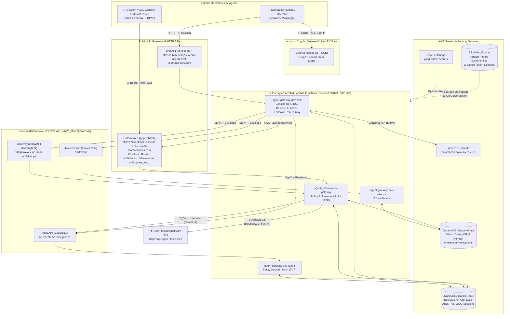

# AWS Serverless Architecture & Component Reference

> Recovery status (8 November 2026): console build **1.0.93** is repaired in source and still requires a new encrypted image release and live acceptance testing. Endpoint identifiers below are recorded deployment values; confirm current CloudFormation outputs before using them.

This document details the architecture of the **Agent Gateway AWS Serverless Edition** deployed in **Paris (`eu-west-3`)**, the AWS services used, how internal zero-trust service communication works, and how the serverless single-PEP architecture compares with the Kubernetes multi-PEP architecture.

---

## 1. End-to-End Architecture Diagram

---

## 2. AWS Components & Three-Stack Deployment Structure

The AWS deployment is organized into **three CloudFormation stacks** in `eu-west-3`:

### 1. Access & Permissions Boundary Stack (`agent-gateway-access-dev`)
- Template: `deploy/aws/deployment-access.template.json`
- **`DeploymentAccessPolicy`**: Grants the deployment role (`AgentGatewayDev`) scoped permissions to manage only `agent-gateway-*` CloudFormation stacks, Lambda functions, HTTP APIs, DynamoDB tables, Cognito pools, Secrets Manager secrets, S3 artifact buckets, and CloudWatch log groups.
- **`WorkloadBoundary`**: An IAM Permissions Boundary (`arn:aws:iam::857710215813:policy/agent-gateway-access-dev-WorkloadBoundary-cUd8zZCXC0P0`) attached to all four Lambda execution roles so no runtime role can ever escalate privileges, modify IAM, or access unrelated account resources.

### 2. Artifact & Activation Stack (`agent-gateway-artifacts-dev`)
- Template: `deploy/aws/artifact-store.template.json`
- **`ArtifactBucket` (`agent-gateway-artifacts-dev-artifacts-zxnumraqhjvy`)**:
  - Private, versioned, SSE-S3 encrypted S3 bucket with public access blocked and HTTPS-only transport enforced.
  - Stores the customer private decryption key (`activation/customer.key`) and four Ed25519 vendor-signed service licences (`activation/{authz,tokensvc,gateway,web}.token`).
  - Each Lambda execution role is granted `s3:GetObjectVersion` on **only** `activation/customer.key` and its own `<service>.token` VersionId.

### 3. Serverless Application Stack (`agent-gateway-dev`)
- Template: `deploy/aws/serverless-images.template.json`
- **Four Encrypted ARM64 Lambda Functions (`512 MiB`, `28s` timeout)**:
  - Packaged using `docker/lambda/Dockerfile` into private ECR repositories (`857710215813.dkr.ecr.eu-west-3.amazonaws.com/agent-gateway-dev/{authz,tokensvc,gateway,web}`).
  - At cold start, `cmd/lambdalauncher` fetches the pinned S3 `VersionId`s for `customer.key` and `<service>.token`, verifies the vendor signature, decrypts the service binary into an owner-only `0700` directory in `/tmp`, deletes the staged key/licence files, and `exec`s the service binary. Warm invocations do not re-read S3 or re-decrypt (~2 ms latency).
- **Five API Gateway v2 HTTP APIs**:
  - **`WebAPI` (`0b7565mq7j`)**: Public HTTPS endpoint for the Web Console.
  - **`GatewayAPI` (`p2ye0fbw36`)**: Public HTTPS endpoint for governed agent traffic. Uses an explicit route allowlist (`/v1/forecast`, `/v1/elevation`, `/v1/marine`, `/mcp`, `/mcp/{proxy+}`, `/tools/{proxy+}`, `/t/{proxy+}`, `/oauth/*`, `/.well-known/*`, `/healthz`) so internal `/v1/*` management routes can never be reached from the public Gateway.
  - **`AuthzAPI` (`l2setzbxx0`)**, **`TokensvcAPI` (`b7xncv7c9k`)**, and **`GatewayInternalAPI` (`0k8h6g0r7k`)**: Internal HTTPS APIs protected by **`AWS_IAM` authorization**. Unsigned requests return `403 Forbidden` at the API Gateway edge before reaching Lambda.
- **Two DynamoDB On-Demand Tables (`DeletionPolicy: Retain`, PITR Enabled)**:
  - **`DomainState`**: Stores delegations, hashed one-time agent secrets, pending and decided human approvals, structured audit events, signup requests, and OIDC browser sessions.
  - **`SecurityState`**: Stores PKCE OAuth authorization codes, DPoP JTI replay nonces, and token/delegation revocations with TTL cleanup.
- **Amazon Cognito User Pool (`eu-west-3_8YUGYY8ao`)**:
  - Administrator-invited user pool (`AllowAdminCreateUserOnly: true`) with PKCE OAuth2 client (`5lnv9k1cn4a5bvfbvad0kui3gl`) and Hosted UI domain `https://agw-weather-857710215813.auth.eu-west-3.amazoncognito.com`.
- **AWS Secrets Manager**:
  - Generates independent 48-byte secrets (`jwt` and `admin`) injected into Lambda configuration via CloudFormation dynamic references.
- **Amazon Bedrock (`eu.amazon.nova-micro-v1:0`)**:
  - Powers the Console's **AI Config Assistant (`✨ AI Config Assistant (Bedrock)`)** via the Bedrock Runtime Converse API (`bedrock:InvokeModel` on the EU Nova Micro inference profile and its four permitted destination model ARNs), with automatic fallback to the local policy rules (clearly labelled fallback) if the AWS account has Bedrock model invocation gated.

---

## 3. Single-PEP Serverless Routing vs. Multiple Delegations

In the Kubernetes edition (`main` / `hosted-tenants`), the Console dynamically creates new in-cluster `Deployment` + `Service` + `Ingress` PEP pods when an operator registers a new upstream container or URL.

In the **AWS Serverless Edition (`aws` branch)**:
- **Upstream PEP**: `agent-gateway-dev-gateway` is a single serverless Lambda PEP configured via the CloudFormation `UpstreamURL` parameter (`https://api.open-meteo.com`) and explicit API Gateway routes (`/v1/forecast`, `/v1/elevation`, `/v1/marine`, `/mcp`, `/tools/*`).
- **Multiple Delegations**: Operators can create **unlimited delegations** in DynamoDB (`DomainState`) for different agents, resource subsets (e.g., `/v1/forecast` only vs. `/v1/forecast` + `/v1/elevation`), actions (`read`, `create`, `delete`, MCP tool names), human approval rules, and spend caps using:
  1. **`🌤️ Quick Weather Delegation`** (one-click preset for `aws-weather-test`),
  2. **`🧙 Delegation Wizard`** (5-step visual wizard for custom agents, resources, approval rules, and spend caps),
  3. **`✨ AI Config Assistant (Bedrock)`** (natural-language policy generation), or
  4. The **`New delegation`** form at the bottom of the Console.

---

## 4. Security Boundaries

- **Workload Authentication vs. Agent Authority**: IAM SigV4 authenticates internal Lambda-to-Lambda hops (`web -> authz`, `gateway -> authz`, `web -> tokensvc`, `web -> gateway-internal`), while end-user OIDC tokens and agent Bearer/DPoP tokens travel inside the signed `X-Agent-Gateway-Authorization` + `X-Agent-Gateway-Target-URI` envelope. Public APIs reject any request carrying `X-Agent-Gateway-*` headers (`403 Forbidden`).
- **Credential Stripping**: Before `agent-gateway-dev-gateway` forwards an allowed request to `https://api.open-meteo.com`, it strips `Authorization`, `DPoP`, `Cookie`, and `X-Agent-*` headers and ignores caller-supplied `X-Agent-Action` / `X-Agent-Resource` overrides on the weather routes.
- **Single-Use Human Approvals**: A `202 Accepted` hold does **not** call Open-Meteo. Once the delegating human approves the request in the Console, the approval record transitions from `pending` to `approved` and is atomically marked `consumed` on the next matching agent retry. A subsequent retry requires fresh human consent (`202`).
- **Immediate Revocation Across Workers**: Revoking a delegation updates DynamoDB (`DomainState` + `SecurityState`), so every Lambda execution environment immediately denies subsequent calls (`403 Forbidden`) even before the 5-minute JWT expires.
