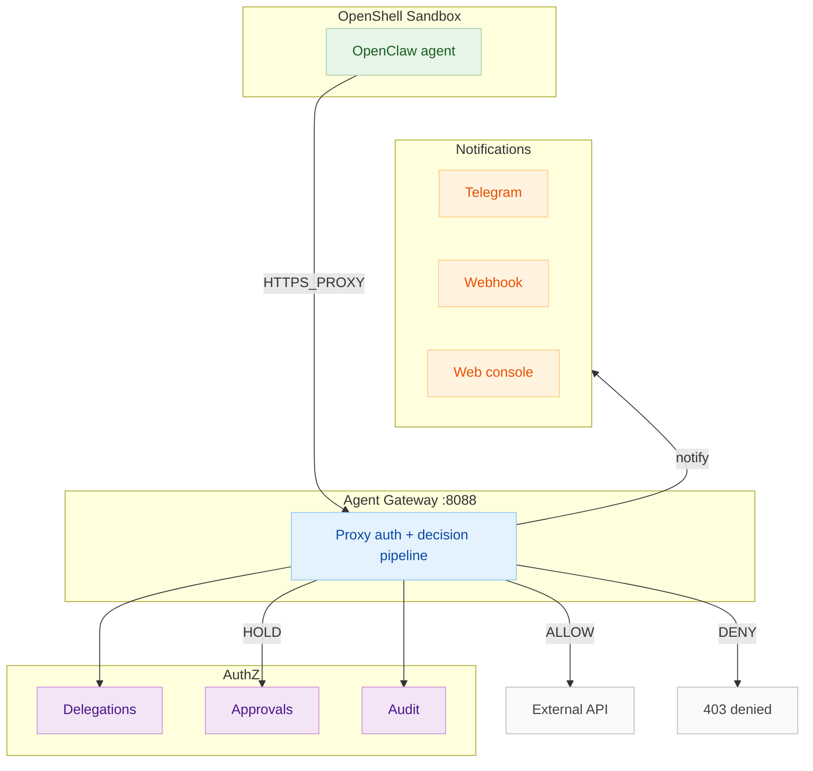

# Architecture

Agent Gateway is four stateless services plus two data stores. The design
separates **decision** from **enforcement** and treats the human as a first
class participant in the authorization loop.

## Services

| Service | Role | State |
|---|---|---|
| `authz` (:8081) | **Decision point.** Owns delegations and the policy engine. Verifies the human's OIDC ID token at delegation creation, binds the delegation to the verified subject, issues agent tokens, answers "is this action allowed?" from the PEP. | delegations (+ decision cache in Redis) |
| `gateway` (:8080, egress proxy :8088 → NodePort 30088) | **Policy enforcement point (PEP).** Sits in front of the tools. Resolves the caller's principal (JWT bearer or SPIFFE SVID), asks authz for a decision, gates approvals, forwards allowed calls to `UPSTREAM_URL`, writes audit events. Also runs the **egress forward proxy** (`GATEWAY_PROXY_ADDR`): an agent runtime routes *all* its outbound networking through it — destination host becomes the resource, HTTP method/CONNECT the action, same decision pipeline (see "Egress enforcement" below). | approvals store + audit sink |
| `tokensvc` (:8082) | Mints short-lived, delegation-scoped JWTs. Refuses to mint for expired or revoked delegations; embeds `jti` for instant revocation. | none |
| `web` (:8083) | Admin console + guided demo. Thin proxy over authz/gateway; never a second source of truth. | none |
| `postgres` | Durable store: `delegations`, `approvals`, `audit_events` (JSONB-first, indexed on the fields the services query). Schema auto-migrates on startup. | — |
| `redis` | jti revocation list + decision cache. | — |

## The authorization loop

```
1  Human (SSO) ──► POST /v1/delegations  (agent, resource, actions, limits,
                                          cap, expiry, id_token)
2  authz verifies the ID token against the OIDC provider (JWKS),
   binds delegation.user_id = token.subject (client-asserted names can only
   agree with it, never override it)
3  Agent ──► POST /token {delegation_id}
   tokensvc refuses revoked/expired delegations; JWT ~= 5 min, embeds jti
4  Agent ──► any tool call on the gateway, Bearer <jwt>
5  gateway resolves principal (JWT w/ revocation check, or SPIFFE SVID)
6  gateway ──► authz /decision  {principal, delegation, action}
7  Policy: resources ⊆ scope, actions ⊆ scope, transaction limits,
   approval rules → ALLOW | REQUIRE-APPROVAL | DENY
8a ALLOW      → forward to UPSTREAM_URL, audit allow
8b HOLD (202) → approval created, bound to (delegation, action_hash),
                NOT executed; the approval is single-use
8b' notification → gateway pushes an approval.required webhook
                (HMAC-signed) to operator automation — n8n / Slack /
                Teams / PagerDuty — so the human learns without
                watching the console; the console also shows a pending
                badge + toast on its approval poll
8c DENY       → refuse in place, audited; nothing forwarded
9  Human decides the pending approval (console, or Approve/Deny from
   the notification card via the operator API); a retry with the
   approved binding executes exactly once
10 Revoke: delegation revoked_at set → decisions deny instantly (authz) and
   even still-valid JWTs are refused at the gateway (redis jti check)
```

## Egress enforcement — every outbound call is one decision

The loop above is *explicit*: the agent calls a declared tool on the gateway
and the gateway sits in front of exactly one upstream. The gateway can
additionally run an **egress forward proxy** (`GATEWAY_PROXY_ADDR`, e.g.
:8088) through which an agent runtime routes *all* of its outbound
networking — NVIDIA OpenShell sandboxes (and OpenClaw, via its community
sandbox) plug in here, with their supervisor speaking the proxy auth
(`Proxy-Authorization`: the delegation-scoped agent token):

```
agent process (sandboxed) ──► OpenShell supervisor ──► gateway egress proxy :8088
                                                        │ verify JWT
                                                        │ resource := destination host
                                                        │ action    := HTTP method (or CONNECT)
                                                        ▼
                                     steps 6-9 of the authorization loop above
                                     (policy → approval hold → audit → forward)
```

Guarantees, shared with the tool path:

* the proxy is **never an open relay** — no `Proxy-Authorization`, no proxy
  (407); an invalid token also answers 407 rather than 403
* an undelegated destination is denied outright by policy (403); an
  allowed destination whose delegation carries the all-outbound approval
  rule is **held (202) per call** — approvals are single-use and bound to
  (delegation, destination host, action)
* the gateway's own control-plane services are unreachable through it
  (internal denylist)
* revocation beats everything, including approved-but-unconsumed holds
* CONNECT tunnels are host:port-allowlisted and relayed blind: the gateway
  sees the destination, never the TLS payload (a later TLS-terminating
  mode can inspect further)

## Trust boundaries

```
┌──────────────────────── browser ─────────────────────────┐
│ human signs in via OIDC; web relays tokens;              │
│ web never verifies them (authz does) ── the web tier     │
│ being compromised cannot mint rights for someone else;   │
│ secrets live in cookies only to power forms in dev       │
└───────────────────────────────────────────────────────────┘
┌─ agents ──► gateway: nothing crosses without a delegation ─┐
│ gateway ──► authz: every decision over the wire            │
│ gateway ──► upstream: only forwarded when ALLOW            │
└────────────────────────────────────────────────────────────┘
```

The web tier is deliberately thin: it relays ID tokens and approval decisions
but cryptographic verification lives only in `authz`, so there is exactly one
place that must trust the IdP.

## Scaling & HA

All four services are stateless when `PERSISTENCE=postgres` (state in
Postgres/Redis), so HA = more replicas behind a load balancer, a managed
Postgres, and managed Redis. No sticky sessions are needed — the OIDC flow is
cookie-based state that any replica can validate. See
[Deployment-Guide.md](Deployment-Guide.md) §6 for the full runbook.

## OpenShell + OpenClaw integration — agent egress through Agent Gateway

### Overview

OpenShell sandboxes (and the OpenClaw agent running inside them) route **all**
outbound networking through the Agent Gateway's **egress forward proxy**.
This brings every outbound call — HTTP, HTTPS, CONNECT tunnels — under the
same authorization loop as explicit tool calls: destination host = resource,
HTTP method/CONNECT = action, same decision pipeline (policy → approval hold →
audit → forward/deny).

### Technical diagram



### The Go egress forward proxy — what it does and why it's there


The **Go egress forward proxy** (enabled via `GATEWAY_PROXY_ADDR=:8088` in the gateway container) is a custom HTTP/HTTPS forward proxy written in Go that runs inside the gateway container. It serves a single purpose: **turn every outbound network connection from a sandboxed agent into an authorization decision**.

#### What it handles

| Traffic type | How it's handled |
|--------------|------------------|
| HTTP (plain) | Intercepted as `CONNECT` to destination:80 → becomes HTTP request to proxy |
| HTTPS | Intercepted as `CONNECT` to destination:443 → TLS tunnel established, proxy sees only host:port |
| CONNECT tunnel (raw TLS) | Blind relay after `CONNECT` + `200 Connection established`; proxy never sees plaintext |

#### Authentication

Every request to the proxy must carry `Proxy-Authorization: Bearer <agent-token>`, where the token is a short-lived JWT minted by `tokensvc` from a valid delegation. The proxy:

1. Validates the JWT signature and expiry
2. Checks revocation in Redis (jti list)
3. Extracts the principal (delegation user_id, agent_id, delegation_id)
4. Passes the principal to the decision pipeline

#### Why a custom Go proxy?

| Requirement | Why custom Go proxy? |
|-------------|---------------------|
| **Proxy-Authorization header** | Standard forward proxies use `Authorization` or `Proxy-Authorization` with Basic auth; we need Bearer JWT validation with jti revocation check |
| **Decision pipeline integration** | Must call authz service for each CONNECT/HTTP request, handle 202 holds, webhook notifications |
| **Audit integration** | Every proxy decision writes a structured audit event (principal, host, action, decision, approval_id) |
| **CONNECT tunnel transparency** | Must relay TLS bytes unchanged after `200 Connection established` |
| **Performance** | Go's net/http and concurrency model handles thousands of concurrent tunnels with low latency |

#### Deployment

| Environment | How it's deployed |
|-------------|-------------------|
| Docker Compose (demo) | `GATEWAY_PROXY_ADDR=:8088` in `docker-compose.egress.yml`; gateway image includes proxy |
| k3s / Kubernetes | Same image; `GATEWAY_PROXY_ADDR=:8088` env var; NodePort 30088 exposes proxy to cluster |
| OpenShell sandbox | Sandbox env `HTTPS_PROXY=http://gateway:8088` + `NODE_USE_ENV_PROXY=1`; agent routes all outbound via proxy |

### OpenShell sandbox ↔ Gateway wiring

```
┌─────────────────────────────────────────────────────────────────────────┐
│                        OpenShell Sandbox (Docker VM)                    │
│  ┌──────────────────┐    HTTPS_PROXY=http://gateway:8088               │
│  │ OpenClaw Agent   │ ──────────────────────────────────────────────►  │
│  │ (Node.js proc)   │    HTTPS_PROXY / NODE_USE_ENV_PROXY=1           │
│  └────────┬─────────┘                                                   │
│           │                                                              │
│           ▼                                                              │
│  ┌──────────────────┐    CONNECT/HTTP + Proxy-Auth                    │
│  │ OpenShell Super- │ ──────────────────────────────────────────────►  │
│  │ visor (nftables) │    Proxy-Authorization: Bearer <agent-token>    │
│  └────────┬─────────┘                                                   │
│           │                                                              │
└───────────┼─────────────────────────────────────────────────────────────┘
            │
            ▼
┌─────────────────────────────────────────────────────────────────────────┐
│                    Agent Gateway Container                               │
│  ┌──────────────────────────────────────────────────────────────────┐   │
│  │  Egress Forward Proxy (:8088)                                     │   │
│  │  • Validates Proxy-Authorization: Bearer <agent-token>          │   │
│  │  • Validates JWT, checks revocation (Redis jti)                 │   │
│  │  • Calls AuthZ /decision (principal, resource=host, action)     │   │
│  │  • On HOLD: returns 202, pushes webhook, waits for approval     │   │
│  │  • On ALLOW: forwards CONNECT/HTTP to destination               │   │
│  │  • On DENY: returns 403                                          │   │
│  │  • Writes audit event to Postgres                                │   │
│  └──────────────────────────────────────────────────────────────────┘   │
└─────────────────────────────────────────────────────────────────────────┘
```

### OpenClaw specifics

OpenClaw runs inside an OpenShell sandbox as a Node.js process. It uses the
standard Node.js `https`/`http` modules, which respect `HTTPS_PROXY` and
`HTTP_PROXY` environment variables when `NODE_USE_ENV_PROXY=1` is set. The
OpenShell sandbox sets these automatically, so OpenClaw requires **no code
changes** to route all its outbound traffic (model calls, tool calls, plugin
fetches) through the Agent Gateway proxy.

### What the sandbox sees vs. what the gateway sees

| Sandbox / OpenClaw | Agent Gateway |
|--------------------|---------------|
| `https://integrate.api.nvidia.com/v1/chat/completions` (HTTPS POST) | Sees `CONNECT integrate.api.nvidia.com:443` + TLS handshake; if delegation allows, relays TLS tunnel |
| `curl https://api.openrouter.ai/v1/models` | Sees `CONNECT api.openrouter.ai:443`; policy check on `api.openrouter.ai:443` |
| `openclaw plugin install github.com/...` | Sees CONNECT to GitHub/GitLab; policy check on destination host |
| Raw TCP (non-HTTP) | Blocked unless delegation explicitly allows `connect` on that host:port |

### k3s deployment specifics

| Component | Address | Notes |
|-----------|---------|-------|
| Gateway egress proxy | `http://<node>:30088` | NodePort 30088 |
| OpenShell sandbox | `HTTPS_PROXY=http://<gateway-node>:30088` | Sandbox env |
| Dex OIDC | `http://dex:5556/dex` (cluster DNS) | Cluster-internal |
| `host.docker.internal` | Resolves to gateway pod IP via `host.docker.internal` in k3s | k3s doesn't support `host.docker.internal` by default; use node IP or CoreDNS |

### Platform notes

| Platform | Gateway IP for sandbox | Notes |
|----------|------------------------|-------|
| Docker Desktop (Mac/Windows) | `host.docker.internal` (resolves to host) | `gw-fwd` forwarder required |
| Linux (Docker Engine) | `172.17.0.1` (docker0 gateway) | Or use `host.docker.internal` if configured |
| k3s / Kubernetes | `<node-ip>:30088` (NodePort) | Use `host.docker.internal` via CoreDNS or node IP |

---

The full bring-up with OpenShell — including the Linux/Mac platform notes —
lives in the main repo's
[`OpenShell-Integration.md`](https://github.com/stevef/agent-gateway/blob/main/OpenShell-Integration.md).

## Policy model

Current `authz` policy (a Rego/OPA authorizer is available as an alternative
engine in the codebase):

- **Resource/action scoping** — the delegation's resource patterns and action
  list are the outer boundary. Everything outside is denied outright.
- **Spend caps with downgrade** — `limits.spend_per_order{max,unit}`: action
  context `amount` above the cap **downgrades allow → "requires approval"**
  rather than denying, so valuable-but-legitimate work is possible with one
  human step. Below the cap it flows through automatically.
- **Count limits** — `max_count` over action `count` denies outright.
- **Approval rules** — declarative "require approval when <condition>" rules
  with an optional rationale, per delegation.

## Security properties

1. **Human identity is verified, not asserted.** Delegations can only bind to
   the OIDC token's subject; a claim in the request body can never create
   rights for somebody else.
2. **Scope is least-privilege and short-lived.** Delegations expire; agent
   tokens are 5 minutes by default and scoped to one delegation only.
3. **High-value actions are two-phase.** The upstream tool is never called
   until the specific action has a fresh, single-use human approval — and the
   human is *told*: the gateway pushes an HMAC-signed `approval.required`
   webhook to operator automation (Slack/Teams/n8n/PagerDuty — setup and
   receiver recipes in [Notifications.md](Notifications.md)), and the console
   surfaces a pending badge + toast, so nobody has to poll by hand.
4. **Revocation beats token validity.** The gateway consults the Redis jti
   list on every call: revocation takes effect immediately even for tokens
   that would pass cryptographic validation for minutes more.
5. **Audit completeness.** Every decision (allow / hold / deny) carries
   acting user, agent id, delegation id, tool/resource/action, policy id,
   approval id and approver — the row in `audit_events` is the record.
6. **Encrypted, licence-gated delivery.** Containers ship encrypted payloads;
   they start only with the customer's private key and a valid, vendor-signed
   licence token — [details](Security-and-Licensing.md).

## Trust boundaries

```
┌──────────────────────── browser ─────────────────────────┐
│ human signs in via OIDC; web relays tokens;              │
│ web never verifies them (authz does) ── the web tier     │
│ being compromised cannot mint rights for someone else;   │
│ secrets live in cookies only to power forms in dev       │
└───────────────────────────────────────────────────────────┘
┌─ agents ──► gateway: nothing crosses without a delegation ─┐
│ gateway ──► authz: every decision over the wire            │
│ gateway ──► upstream: only forwarded when ALLOW            │
└────────────────────────────────────────────────────────────┘
```

The web tier is deliberately thin: it relays ID tokens and approval decisions
but cryptographic verification lives only in `authz`, so there is exactly one
place that must trust the IdP.

## Scaling & HA

All four services are stateless when `PERSISTENCE=postgres` (state in
Postgres/Redis), so HA = more replicas behind a load balancer, a managed
Postgres, and managed Redis. No sticky sessions are needed — the OIDC flow is
cookie-based state that any replica can validate. See
[Deployment-Guide.md](Deployment-Guide.md) §6 for the full runbook.
