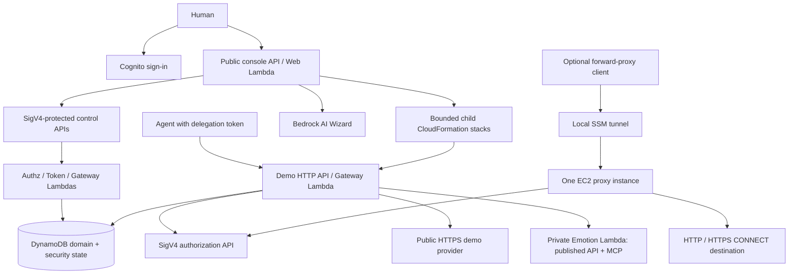

# AWS deployment architecture

The deployment scripts select a **single-region serverless control plane with optional EC2 forward proxy**. The default region is Paris (`eu-west-3`). This document describes provisioned design, not an inventory of a particular AWS account.

## Stack ownership and components

* **Deployment access** (`deployment-access.template.json`): bounded deployment policies, workload permissions boundary and a fixed CloudFormation role for child demos. Applying named IAM resources is an explicit administrator operation. Web runtime permissions allow only application-owned demo stack lifecycle and passing this reviewed role; child templates do not create IAM roles.
* **Artifacts** (`artifact-store.template.json`): private versioned activation storage and image preparation inputs. S3 object versions pin customer keys and gateway product licences.
* **Application** (`serverless-images.template.json`): four encrypted ARM64 Lambda images (web, gateway, authz, tokensvc), public console/gateway HTTP APIs, three IAM-protected internal HTTP APIs, Cognito, DynamoDB domain/security tables, Secrets Manager and execution roles. The baseline weather routes remain available.
* **Demo children**: one dedicated gateway Lambda and public HTTP API per API/MCP demo, sharing authorization and durable domain/security state. Public routes contain only that demo's governed path; operator routes are not exposed. Weather/geocoding/users/refunds use public HTTPS providers. Refunds is a JSONPlaceholder simulation.
* **Emotion child**: the dedicated gateway invokes a private Lambda directly through IAM `lambda:InvokeFunction`. That backend packages the actual published Emotion API and MCP binaries; it has no public function URL or API integration. The native container enforces its licence. A missing/expired licence may produce a native MCP tool error after the gateway allows the call. No gateway Emotion licence gate is added.
* **Optional proxy** (`proxy-vm.template.json`): one ARM64 EC2 instance in one subnet/AZ, an encrypted disposable root disk, its own small VPC/internet route, SSM instance role and no security-group ingress. SSM port forwarding provides local access to the proxy. It shares the application's authorization and state but does not host arbitrary demo databases/connectors.

The AI Wizard retains the Bedrock Converse integration, EU Nova Micro inference profile, SigV4 signing and required model permissions in both the web identity policy and workload boundary. EU inference routing is model-service routing; it does not provide cross-region failover for this application.

## Availability and failure behavior

| Component | What the scripts select | HA/recovery limit |
|---|---|---|
| Lambda + HTTP APIs | AWS-managed regional request processing, scalable independent workers | No reserved capacity/warm concurrency; in-flight calls can fail; no cross-region deployment/failover |
| DynamoDB | Shared on-demand domain/security tables, TTL where applicable, point-in-time recovery and retained data | No global tables or cross-region application recovery automation; backup restoration is an operator action |
| Console/OAuth/approvals | Durable state shared between workers, atomic approval consumption/replay controls | Existing browser/request connections can fail; clients must handle expiry/retry without duplicating mutations |
| Demo gateways | Separate Lambda/API per demo with shared authorization | Separation does not remove shared control-service dependencies |
| Emotion | Private on-demand Lambda, vendor model initialization inside its worker | Cold starts, model readiness and vendor licence can prevent inference; no permanently warm model service |
| Optional proxy | Single EC2 instance; systemd process restart; SSM access | **Single instance, single AZ; no load balancer, ASG replacement or HA failover.** Host/AZ failure loses active tunnels/connections |

HTTPS CONNECT authorizes the destination when establishing the tunnel. It cannot inspect operations inside TLS, and revoking a delegation does not retroactively inspect/terminate an already-open tunnel. Use the API/MCP gateway for per-method/body approval.

## Operations

Start with [repeatable Make workflow](https://github.com/stevef1uk/agent-gateway/blob/aws/docs/aws/make-workflow.md), then use the [demo prerequisite matrix and runners](AWS-Demos.md). The [optional proxy lifecycle](https://github.com/stevef1uk/agent-gateway/blob/aws/docs/aws/proxy-vm.md) explains billing and deletion. Application teardown must delete owned demo children and the optional proxy before shared services; retaining data/images is separate from retaining compute.
