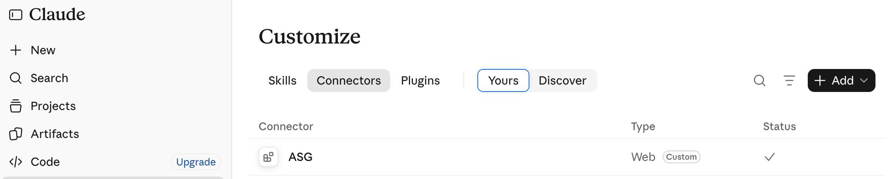
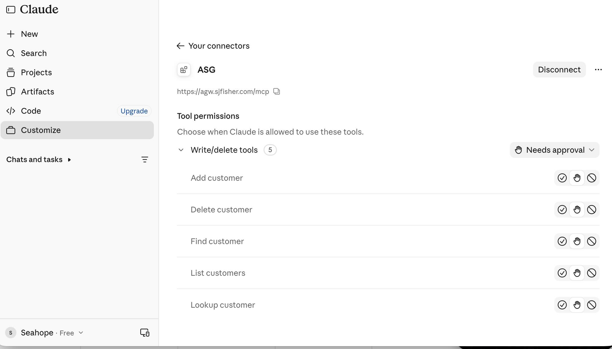
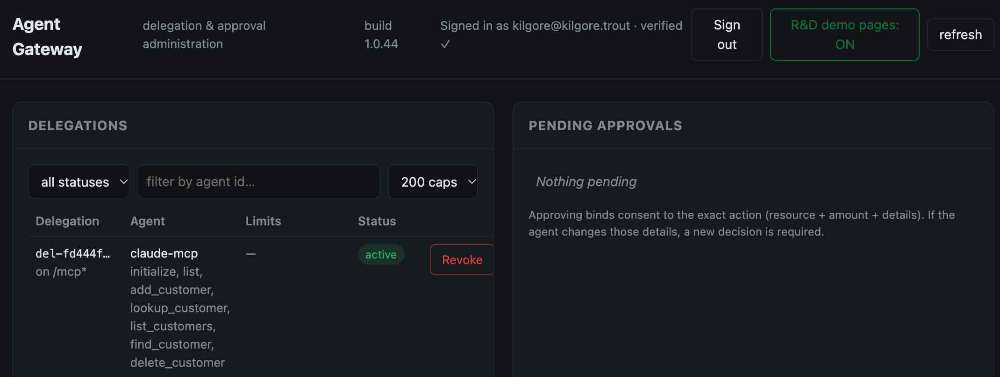
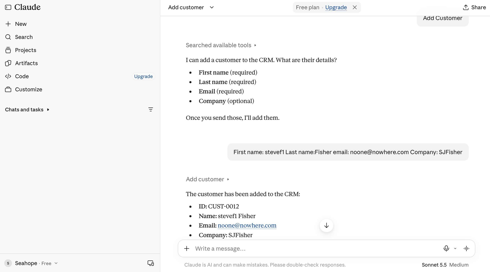
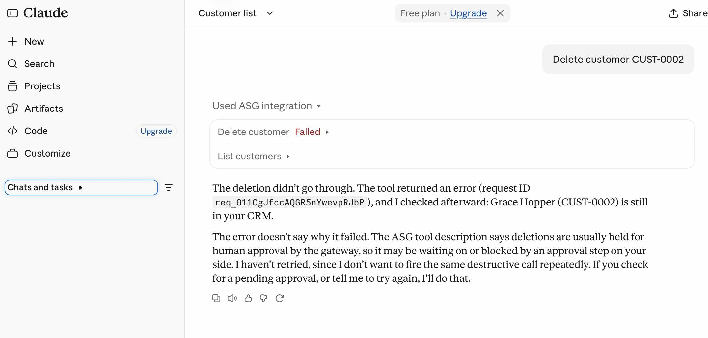
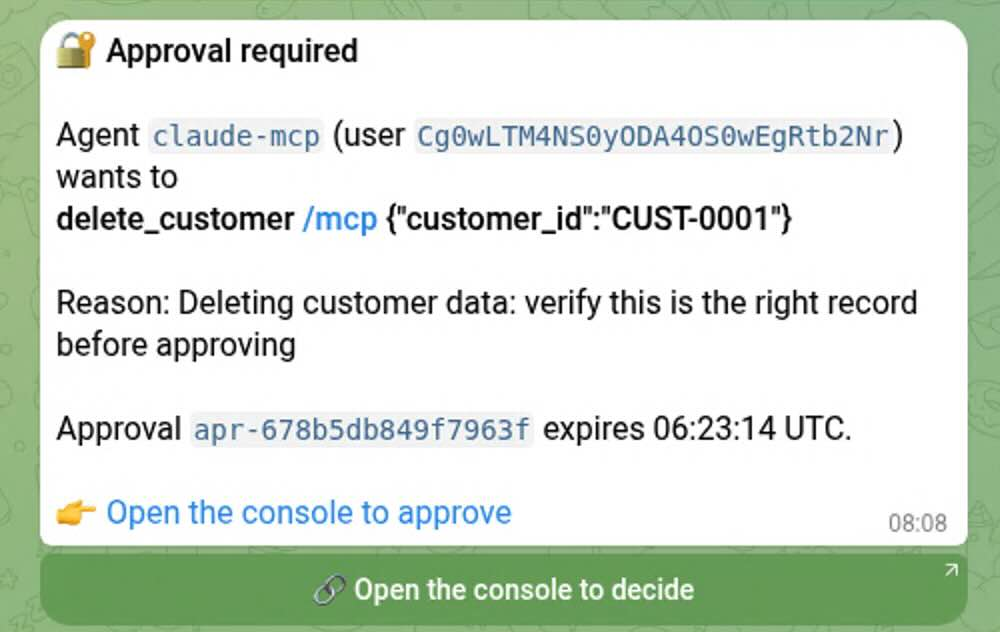
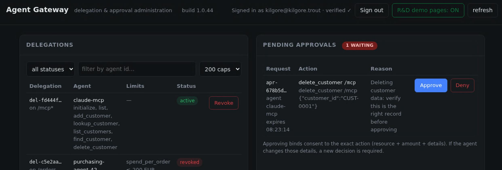
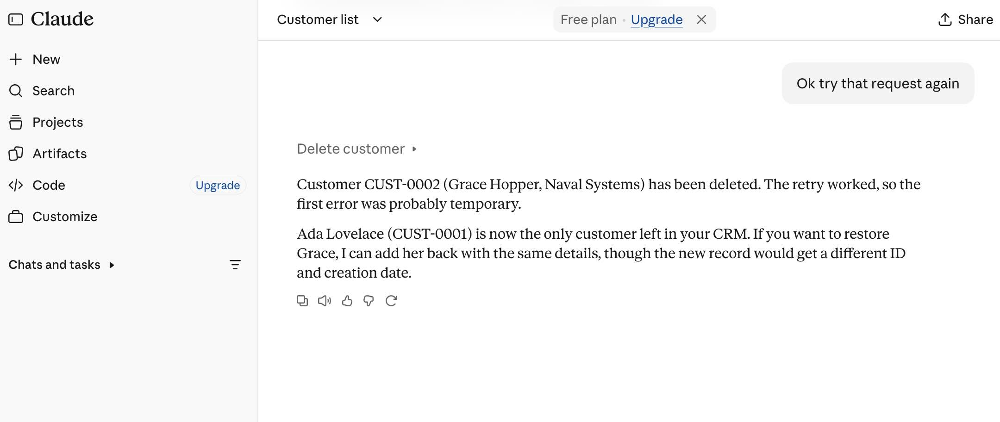

# Run the CRM demo from Claude — end-user tutorial

> *"I want to watch Claude (the web app, from my browser, with zero local
> software) call a protected CRM through the Agent Gateway — including the
> part where it asks a human before deleting anything."*

No coding, no local installs. All you need: a browser, a claude.ai account,
and the gateway running at `https://agw.sjfisher.com`. Every step below is
illustrated with a screenshot in
[`images/claude/`](../images/claude/).

**What you'll end up with**: Claude connected to the CRM demo — adding
customers at will, with every delete **held for your approval** on Telegram
and in the admin console, and every call written to the audit trail.

---

## Prerequisites

| You need | Notes |
|---|---|
| A browser | any modern one |
| A claude.ai account | the custom-connector feature needs Claude |
| An active delegation | **provided by the stack admin** via `k3s/create-claude-delegation.sh`; if you see *"No active delegation exists for your account"* connect, that's the missing piece — ask whoever runs the gateway, or see [Claude-Integration.md](Claude-Integration.md) for why this must be provisioned ahead of time |

## Step 1 — add the connector in claude.ai

1. claude.ai → **Customize → Connectors**
2. **Add connector → custom connector**
3. URL: `https://agw.sjfisher.com/mcp`
4. OAuth client: **Register automatically** — your connector registers
   itself with the gateway (DCR); nothing to type beyond the URL
5. The OAuth popup opens at the gateway's identity provider — **one click
   sign-in** — and Claude comes back connected

## Step 2 — what the connector looks like after sign-in

Open the connector's detail page: it lists every CRM tool Claude learned
about (add / lookup / list / find / delete customer), and Claude marks the
write/delete tools "**Needs approval**" by default — that is Claude's own
safety prompt *on top of* the gateway's enforcement. What Claude cannot
grantee is what happens after it calls; that's what the gateway adds.

## Step 3 — check your delegation in the gateway console

Open `https://agw.sjfisher.com` (sign-in is the same one-click flow you just
did). Your delegation is listed under **Delegations** — the agent is
`claude-mcp`, the resource `/mcp*`, and the action list includes the
discovery acts (`initialize`, `list`) plus the five CRM tools. This record
is what the connector auto-binds to; **this** row is the reason Connect
worked without any delegation chooser.

## Step 4 — first governed call

In a Claude chat: *"list the customers in the CRM"*. The call rides through
the gateway — resolved to you + your delegation, authorized, audited — and
Claude reads back the contents.

## Step 5 — a normal write: add a customer

*"Add a customer — first name Steve, last name Fisher, email
noone@nowhere.com, company SJFisher."* Claude invokes `add_customer`, the
gateway authorizes it under your delegation (no human gate: adds are not
marked risky), and the CRM answers with the new record (`CUST-0012`).

## Step 6 — the differentiator: DELETE is HELD

*"Delete customer CUST-0002."* Watch what Claude shows:

The tool call reads **Failed** — nothing happened. What actually occurred
is the gateway issued a **202 hold**: the delete is parked, the CRM was
never touched (Claude confirms this out of band), and an approval request
is pending. *This is the property worth selecting a gateway for: the
model's say-so is not authorization.*

## Step 7 — two ways a human hears about it

### Telegram

The card names the agent (`claude-mcp`), the verified user, the exact
operation (`delete_customer /mcp {"customer_id":"CUST-0001"}`), the reason
from the delegation's approval rule, the approval id and its expiry — and
links to the console to decide.

*(Not wired on your instance? `APPROVAL_TELEGRAM_BOT_TOKEN` +
`APPROVAL_TELEGRAM_CHAT_ID` on the gateway enable it — see
[Notifications.md](Notifications.md). The console path needs nothing.)*

> **Who sees Telegram cards:** the operator's chat only — the bot token and
> chat id belong to whoever runs the infrastructure, so the card lands in
> *their* Telegram. If you're running this demo against someone else's k3s
> instance, the approval decision happens in *their* Telegram and console;
> your way in is the console link if they share it, or ask them to approve.
> Per-user notification channels (each approver getting their own card)
> are roadmap — today the console is the neutral-surface decision point.

### The console

Open `https://agw.sjfisher.com` — the pending badge shows **1 WAITING**;
the card above shows request, action (with the exact argument), and the
Approve / **Deny** buttons.

## Step 8 — approve, then let Claude retry

Approve in whichever surface you opened (Telegram's button deep-links to
the same console — one decision surface, one identity for the approver),
then tell Claude *"Ok, try that request again"*:

The retry executes **exactly once** — the approval is single-use and bound
to the exact action hash, so an approved delete never doubles up, and an
argument change would have demanded a fresh decision. Ask Claude to list
customers again: the record is gone (the CRM keeps the other one).

**Try the deny path too** — deny instead of approve and re-ask; the denial
is sticky (it survives the delegation and re-grants until explicitly
cleared) and Claude relays the refusal honestly.

## Step 9 — see every decision

In the console the audit trail is one click away (and queryable via
Postgres — the audit contract is documented in
[Policy-and-OPA.md](Policy-and-OPA.md) and
[`docs/Identity-Model.md`](Claude-Integration.md) in the source repo). Every
row carries your verified identity, the client (`cli-…`), the agent, the
tool, the decision and the reason.

**Revoke whenever you like** — the red **Revoke** button next to the
delegation kills it instantly; Claude's very next call fails with 403 even
though its token is still cryptographically valid. That is the last thing
you want in a demo: proof that access is a revocable *grant*, not a
permanent hostage to a long-lived API key.

## If something doesn't work

| Symptom | Cause | Fix |
|---|---|---|
| *"No active delegation exists for your account"* on Connect | no active delegation bound to your sign-in identity (expired / wrong subject / never created) | admin: `k3s/create-claude-delegation.sh [--replace]` — see [Claude-Integration.md](Claude-Integration.md) |
| *"Couldn't connect to the server"* right after connecting | delegation lacks the `initialize`/`list` discovery actions — the handshake is denied before any tool runs | re-run the delegation script (it includes them); check the audit rows: `initialize … deny` |
| *Unregistered redirect_uri* 400 at sign-in | the gateway's Dex config is missing `https://<host>/oauth/idpcallback` (connector) or `/oidc/callback` (console) | both must be registered; the k3s manifest ships them |
| Browser TLS warning | Let's Encrypt certificate not yet issued | DNS must resolve to the cluster first — see [Deployment-Guide §6.6](Deployment-Guide.md#66-reinstalling-on-a-new-k3s-cluster) |
| Connector works, then stops hours later | the delegation's TTL passed | re-provision with a longer `TTL` (hours, not minutes) |

## Where to go next

- The full ops-side story (OAuth machinery, per-tool enforcement, honest
  limits): [Claude-Integration.md](Claude-Integration.md)
- Protecting **your** MCP server the same way:
  [Protecting-Your-MCP.md](Protecting-Your-MCP.md)
- Deploying this on your own cluster:
  [Deployment-Guide §6.6](Deployment-Guide.md#66-reinstalling-on-a-new-k3s-cluster)
- The same CRM under REST: [Protecting-Your-API.md](Protecting-Your-API.md)
