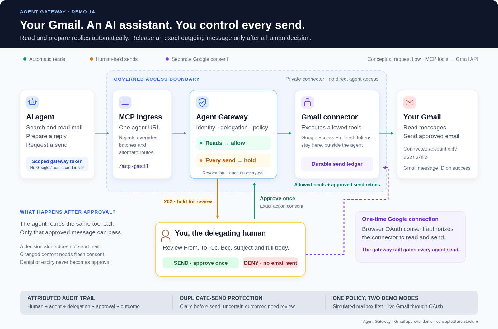

# Demo 14 — Gmail assistant with human-approved sending

**Read automatically; approve every send.** This demo gives an MCP-capable
agent three tools: `search_email`, `get_email` and `send_email`. The gateway
holds every send for approval of its exact recipients, subject and body.
Google credentials belong to a private connector, never the agent.



*Follow the top row for tool calls. The amber branch holds sends for your
decision; green returns single-use consent to the gateway. The purple path
connects Google credentials to the private connector. After approval, the
agent retries the unchanged message to send it.*

[Editable vector diagram (SVG)](../images/gmail-approval-architecture.svg)

Two modes use the same MCP interface and gateway policy:

- **Fake mail (default):** two seeded messages, persistent simulated Sent
  records and a send-attempt counter. No Google account or model key needed.
- **Live Gmail:** Google OAuth and actual Gmail reads/sends. Human approval
  is mandatory; unattended `--yes` mode is refused before delegation creation.

The protocol walkthrough is deterministic. A separate agent-session mode
lets your own AI runtime use the same tools while you run an approval desk.

## 1. Start the stack

Requirements: Python 3.10+, Docker Compose or Podman Compose, and the demo
gateway licences already included in this repo. Run from the repository root:

```bash
make gmail-up
make gmail-demo
```

Without Make:

```bash
python3 demo/gmail/demo.py --init
docker compose -f demo/docker-compose.yml -f demo/docker-compose.gmail.yml \
  up -d --build --wait tokensvc gmail-ingress
bash demo/gmail-demo.sh
```

Initialization creates a random operator token in the gitignored
`demo/gmail/credentials/operator.env` with mode `0600`. Compose and the
operator runner use it; agent configurations never contain it. Re-running
initialization retains the same token.

Only the core authz/token/Dex/Postgres/Redis services and the three Gmail
services start. The agent entry point is **http://localhost:8089/mcp-gmail**.
Neither the Gmail connector nor its PEP publishes a host port. A restricted
ingress rejects `X-Agent-*` overrides, JSON-RPC batches and alternate routes.

### Walk through approval

The runner signs in as Alice using the local Dex fixture, creates a
30-minute delegation, reads a seed message, then attempts a send:

1. See `HELD: apr-…` and the unchanged send-attempt count.
2. Review the connected mailbox and **all seven message fields** in the
   terminal. JSON escaping makes control characters visible.
3. Type **SEND** to approve that exact email once.
4. The identical retry executes; fake mode prints `message_id: fake-…`.
5. Review the second, injected-style proposal and type **DENY**.
6. Denied retries fail; revocation blocks the still-valid token. The runner
   checks correlated approval/audit events and backend send evidence.

Fake mode also checks every field independently against an unconsumed
approval, including Bcc and body text. The protocol driver deliberately
exercises malicious calls; it does not claim an AI model was involved.

For unattended fake-mail verification:

```bash
bash demo/gmail-demo.sh --yes
```

The runner revokes its delegation on exit and denies pending approvals where
possible. Closing it never grants consent. The persistent ledger and fake
mail history remain available for inspection.

## 2. Connect real Gmail

1. Create a Google Cloud project and enable **Gmail API**.
2. Configure the Google OAuth consent screen. For an External app in Testing
   mode, add the Gmail account you will connect as a test user.
3. Create a **Desktop app** OAuth client and download its JSON to
   `demo/gmail/credentials/client.json`.
4. Install the human-side helper's dependencies in a virtual environment:

```bash
python3 -m venv demo/gmail/.venv
demo/gmail/.venv/bin/pip install -r demo/gmail/requirements.txt
demo/gmail/.venv/bin/python demo/gmail/oauth.py \
  --client demo/gmail/credentials/client.json
```

The helper opens Google's system-browser flow, checks OAuth state, uses PKCE
and a loopback callback, and saves `credentials/token.json` with mode `0600`.
It requests only:

```text
https://www.googleapis.com/auth/gmail.readonly
https://www.googleapis.com/auth/gmail.send
```

Run this helper as the human, outside the agent runtime. Both scopes must be
granted. Google's grant authorizes the connector; **per-message consent is
enforced by the gateway**, not by Google's OAuth scope.

Start live mode with the connected mailbox's actual address:

```bash
export GMAIL_MODE=live
export GMAIL_MAILBOX=your-account@gmail.com
make gmail-up
```

The connector verifies that Google's `/profile` matches `GMAIL_MAILBOX`.
It always uses `users/me`; tools cannot supply another account or token.

Have someone send that mailbox a test message titled
**Agent Gateway demo — meeting request**, then run:

```bash
bash demo/gmail-demo.sh --recipient your-controlled-recipient@example.net
```

Use a recipient you control. The terminal pauses before sending. After the
approved retry, inspect Gmail **Sent** and the recipient inbox. The returned
Gmail message ID proves API acceptance, not final recipient delivery.

Outgoing mail is plain text, at most 4,000 UTF-8 bytes, with at most five
total To/Cc/Bcc recipients. No attachments or Gmail draft mutations are
exposed. A reply uses the source message ID for Gmail threading; the outgoing
body and recipients still come exclusively from the approved snapshot.

**Linux file ownership:** the image runs as UID/GID 1000 by default. If your
credential files are owned by another UID/GID, export `GMAIL_UID=$(id -u)`
and `GMAIL_GID=$(id -g)` before the first build/start. Existing data volumes
keep their ownership; update that volume's ownership as the operator when
changing the image's UID/GID. Keep credential files private rather than
making them world-readable.

To return to fake mail:

```bash
export GMAIL_MODE=fake
unset GMAIL_MAILBOX
make gmail-up
```

## 3. Give your AI agent the tools

Start an interactive operator approval desk:

```bash
bash demo/gmail-demo.sh --agent-config demo/gmail/agent-config.json
```

The runner creates a fresh delegation and an exclusive `0600` temporary file:

```json
{
  "mcpServers": {
    "gmail": {
      "url": "http://localhost:8089/mcp-gmail",
      "transport": "streamable-http",
      "headers": {"Authorization": "Bearer <scoped agent token>"}
    }
  }
}
```

Load that entry into your MCP client. For OpenClaw's configuration shape,
place the `gmail` entry under `mcp.servers` instead of `mcpServers`. The
[agent prompt](../demo/gmail/agent-prompt.md) supplies the task and hold/retry
instructions. Tell the agent which recipient you control.

The operator desk polls for held actions from **its own delegation**, parses
the complete gateway-stored message snapshot, and asks you to type SEND or
DENY. After approving, tell the agent to retry the identical tool arguments.
The gateway's hold is an HTTP `202` JSON-RPC result with
`result.status: approval_required` and `result.approval_id`. MCP clients
differ in handling that status; manually resume the chat if necessary.
The tested protocol runner handles it directly.

The desk refuses to approve a missing/truncated preview. It removes the
temporary config and revokes the delegation on normal exit/Ctrl-C. Session
credentials last at most 30 minutes; start a fresh session afterward.

The operator desk works without the web console. An existing console can
show shared-store approvals, but its generic view/client support is separate
from the tested terminal flow. Telegram, when configured through the repo's
existing variables, provides notifications and a console link; the desk
remains a full-content decision surface.

For a sandboxed agent, expose only the ingress and model-provider destinations
to its network. If the runtime cannot reach host loopback, bind to an
appropriate host address using `GMAIL_BIND_ADDR` and set `GW` to the URL that
both the operator and agent can reach. Never attach the agent to the Compose
default, Gmail-front or Gmail-backend networks or mount the credential store.

## 4. Verification

Offline validation, MIME, HTTP ingress and durable-ledger tests:

```bash
make gmail-test
```

Integration checks against the running **fake-mail** stack (including the
real approval desk and a complete 3.5KB message preview):

```bash
GMAIL_GATEWAY_TESTS=1 python3 -m unittest discover -s demo/gmail -v
```

Real expiry test with a short-lived approval window:

```bash
GMAIL_APPROVAL_TTL=10s docker compose \
  -f demo/docker-compose.yml -f demo/docker-compose.gmail.yml \
  up -d --wait gateway-gmail
bash demo/gmail-demo.sh --yes --expiry-check
# Restore the normal human decision window:
GMAIL_APPROVAL_TTL=15m docker compose \
  -f demo/docker-compose.yml -f demo/docker-compose.gmail.yml \
  up -d --wait gateway-gmail
```

Inspect backend evidence as the operator:

```bash
docker compose -f demo/docker-compose.yml -f demo/docker-compose.gmail.yml \
  exec -T gmail-mcp python connector.py evidence
```

The persistent SQLite ledger claims an operation **before** Gmail I/O.
Concurrent requests cannot both send it. Reusing its operation ID with
changed content fails. A completed operation returns its saved Gmail ID if
an authorized retry reaches the connector. A timeout/crash leaves it
**uncertain** and blocks automatic retries, even after restart. Reconcile
uncertain operations against Sent using the stable MIME Message-ID before
deciding on any new send; Gmail is not assumed to deduplicate requests.

## 5. Configuration and troubleshooting

| Setting / symptom | Meaning / resolution |
|---|---|
| `GMAIL_HOST_PORT` | Published ingress port, default `8089`; runner follows it |
| `GMAIL_BIND_ADDR` | Published interface, default `127.0.0.1` |
| `GMAIL_MODE`, `GMAIL_MAILBOX` | `fake` / `live`, and the Google-verified live mailbox; recreate services after changing |
| `GMAIL_APPROVAL_TTL` | Go duration, default `15m`; recreate Gmail PEP to change |
| `CONTAINER_ENGINE=podman` | Runner evidence commands use Podman; use `ENGINE=podman make gmail-up` for startup |
| `GW`, `AUTHZ`, `TS`, `DEX` | Operator endpoint overrides |
| `ID_TOKEN` | Verified gateway human ID token; absent means local Alice fixture login |
| `GMAIL_ADMIN_TOKEN` / `ADMIN_TOKEN` | Operator-runner override, must match the running Gmail PEP/ingress; default comes from private operator file |
| Missing `operator.env` | Run `python3 demo/gmail/demo.py --init` before Compose |
| Google refresh / startup fails | Check both granted scopes, mailbox match and credential file permissions; rerun OAuth helper after revoked/expired credentials |
| No meeting request found | Manually seed the live mailbox; fake mode already has seed messages |
| `202` without sending | Expected hold; approve, then retry unchanged |
| `410` on decision | Approval expired; request fresh consent |
| Uncertain operation | Do not automatically resend; reconcile against Gmail Sent |

This uses the repository's local demo identity/database fixtures. For live
deployment, use your real IdP and protect **all** management and alternate
gateway endpoints sharing the approval store. The agent must only reach its
governed entry point; a local process with operator filesystem/network access
is outside that isolation boundary. Reading mail makes it available to the
agent/model; approval governs Gmail sends, not every possible data transfer.

Disconnecting the gateway delegation does not revoke Google's grant. To
disconnect the mailbox, stop `gmail-mcp`, revoke the app in your Google Account
connections, and remove its local token file. Email bodies are retained in
gateway approval summaries for review; fake Sent also persists in the demo
data volume. Use test messages when demonstrating the flow.

Architecture and original acceptance criteria:
[Gmail approval demo design](Gmail-Approval-Demo-Design.md).
