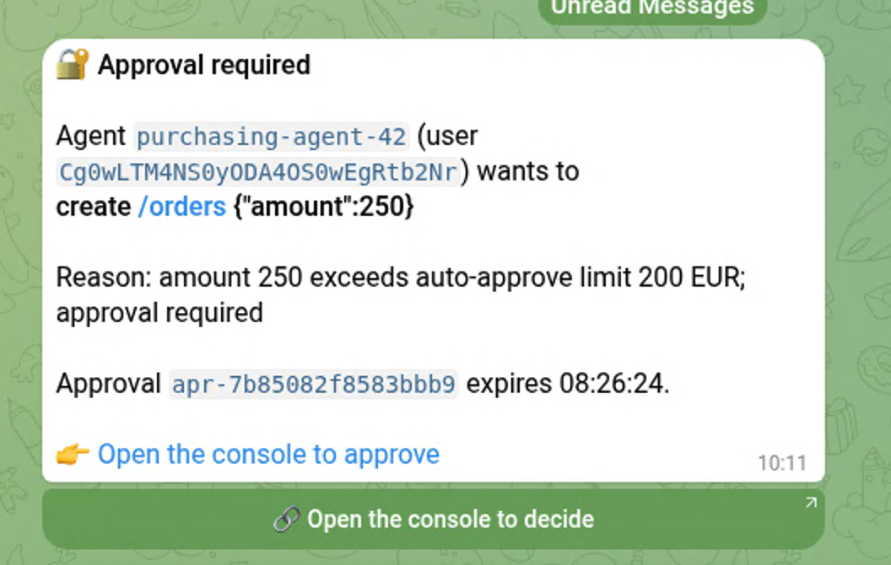

# Approval notifications — reaching the right human

Agents act on behalf of individual users. When the gateway holds a high-risk
action it can push the decision to your automation, so the human who delegated
the rights is *told* — and only they can authorize it.

## 1. Configure the webhook (gateway service)

```yaml
environment:
  - APPROVAL_WEBHOOK_URL=https://automation.internal/agent-gateway/approvals
  - APPROVAL_WEBHOOK_SECRET=<random 32+ bytes>   # signs every delivery
```

(Uncomment the matching lines in `demo/docker-compose.yml` to try it in the
demo stack.)

## 2. What you receive

Each delivery is `POST` with `Content-Type: application/json` and these
headers:

| Header | Meaning |
|---|---|
| `X-Agent-Gateway-Event` | `approval.required` |
| `X-Agent-Gateway-Timestamp` | unix seconds of the signing time |
| `X-Agent-Gateway-Signature` | `sha256=<hex>` of `HMAC_SHA256(secret, "<timestamp>.<body>")` |

Payload (plain JSON, so any orchestrator can consume it):

```json
{
  "event": "approval.required",
  "approval_id": "apr-1f2e3d4c5b6a7f80",
  "delegation_id": "del-…", "agent_id": "purchasing-agent-42", "user_id": "<subject>",
  "tool": "orders", "resource": "/orders", "action": "create",
  "args": {"amount": 250, "supplier": "acme"},
  "reason": "amount 250 exceeds auto-approve limit 200 EUR",
  "expires_at": "2026-10-16T15:30:00Z",
  "how_to_approve": {
    "method": "POST", "url": "/v1/approvals/",
    "headers": {"X-Admin-Token": "<GATEWAY_ADMIN_TOKEN>", "Content-Type": "application/json"},
    "body_template": "{\"approval_id\":\"%s\",\"approver_id\":\"<you>\",\"approved\":true}"
  }
}
```

The payload never contains your admin token — `how_to_approve` only documents
the call shape; receivers substitute their own copy of
`GATEWAY_ADMIN_TOKEN` when they POST the decision back.

**Receiver-side verification (do this before trusting any payload):**

```python
import hmac, hashlib
def verify(secret, timestamp, body, signature):
    expected = "sha256=" + hmac.new(secret.encode(),
        f"{timestamp}.".encode() + body, hashlib.sha256).hexdigest()
    return hmac.compare_digest(expected, signature) and            abs(int(timestamp) - int(time.time())) < 300
```

Receiver recipes:

* **n8n / workflow hub (recommended translator)** — `Webhook` node receives
  the event → a `Code`/`Crypto` step verifies the signature and timestamp →
  route to Slack/Teams/email/PagerDuty and offer Approve/Deny buttons that
  call `how_to_approve` via an `HTTP Request` node. This is also the bridge
  for channels that need their own payload format.
* **Slack / Teams** — their incoming-webhook APIs expect channel-specific
  JSON, so place a translator (n8n, Zapier, a Lambda) in between; the gateway
  event stays the single source of truth. Post the `approval_id` + summary as
  the card body with two actions (`approved` true/false, `approver_id` = the
  clicking user's chat identity — it is written to the audit trail).
* **PagerDuty** — forward to the Events API v2 with `approval_id` as the
  dedup key; auto-resolve when the decision endpoint returns 200.
* **Plain HTTP sink / SIEM** — the event is bare JSON; archive or route as-is.

**Approver binding — only the right human can authorize.** Agents act on
behalf of individual users, so the gateway refuses a decision whose
`approver_id` differs from the delegating user the approval is bound to
(`403 only the delegating user (…) can approve this action`). The console
always supplies the signed-in session's verified subject; webhook receivers
(chat bots) must map the clicking user's chat identity to their IdP subject
and send that. Disable only for explicit group-approver deployments with
`APPROVAL_ENFORCE_APPROVER=false` (not recommended). Routing therefore goes
user-first: the event carries the verified `user_id` and, when the IdP
provided it at delegation time, `user_email` — deliver the card as a DM to
that person (directory lookup by email/subject), not to a group channel;
group channels are safe only because strangers cannot approve.

Operational notes:

* **Delivery is best-effort, single attempt** (5 s timeout, errors logged).
  Notification must never change enforcement; pair the webhook with the
  console's pending list for guaranteed visibility.
* The receiver may see duplicates after its own retries — treat
  `approval_id` as the idempotency key.
* Approvals expire (default ~15 min). Silence beyond the expiry means the
  action was denied by default — the agent must retry, generating a fresh
  event.
* Use an `https://` webhook URL; the secret and approval metadata travel in
  the body.

## 3. Telegram instead of (or alongside) the webhook

```yaml
environment:
  - APPROVAL_TELEGRAM_BOT_TOKEN=<token from @BotFather>
  - APPROVAL_TELEGRAM_CHAT_ID=<your user id, or a group's chat id>
  - APPROVAL_CONSOLE_URL=http://192.168.1.53:8083   # where the approver's link lands
```

(Compose reads it from the gitignored `demo/.env`; the k3s manifest uses the
cluster secret `agentgw-telegram` for both credentials. Finding the chat id:
message the bot from the target chat, then call
`https://api.telegram.org/bot<token>/getUpdates` once and read
`result[0].message.chat.id`.)

> **Ownership note:** Telegram cards go **exactly to the chat this token
> serves — the infrastructure owner's** chat (or their group), because that
> is whose credential the gateway holds. Other humans/approvers get nothing
> on Telegram; they decide via the console (`APPROVAL_CONSOLE_URL`), which
> enforces its own approver binding. Pointing the chat at a shared group
> works but does not remove that: the group's members are the notified
> approvers, chosen by the operator. Per-user notification channels are
> roadmap.

Every held action then lands in that chat as an HTML-formatted card —
agent/user, the action summary, the rule's rationale, the `approval_id`, its
expiry, a **clickable "Open the console to approve" link**, and an
**inline keyboard button** ("🔗 Open the console to decide") that opens the
same view with one tap:

> 🔐 **Approval required**
>
> Agent `purchasing-agent-42` (user `Cg0w…`) wants to
> **create /orders `{"amount":250,"supplier":"acme"}`**
>
> Reason: amount 250 exceeds auto-approve limit 200 EUR; approval required
>
> Approval `apr-1f2e3d4c5b6a7f80` expires 07:56:12.
>
> 👉 [Open the console to approve]
> [ 🔗 Open the console to decide ]

**What that looks like in the chat** — the card as the approver receives it,
link and one-tap button included:



**One console per deployment.** Each running stack (compose, k3s, and
production alike) has its **own** approval store — a hold raised on k3s is
not visible on the compose console and vice versa. The card's button links
to the console of the stack that raised it (per-deployment
`APPROVAL_CONSOLE_URL`), which is why the request you tapped appears on
**that** console. Restraint tip: run one stack at a time — or expect two
consoles, two pending lists.

**Routing caveat (Telegram rule):** the button URL must be **routable by
the recipient** — Telegram rejects non-routable addresses (e.g. `localhost`
or `127.0.0.1`) with a 400 and the whole card fails to send. Use the
machine's LAN/node address; `APPROVAL_CONSOLE_URL` is per-deployment
(compose: the host IP; k3s: the NodePort address `http://<node>:30083`).

Security notes: keep the bot token as an environment/secret (never in git);
deliver to user or private approver chats — never public channels; all
user-controlled values are escaped before sending; failed sends are logged
and never change enforcement. Approving from chat is deliberately out of
scope (no reply flows): decide in the console or via your webhook
automation; an interactive chat-button approver bot is tracked on the
roadmap.

## 4. Quick test with a local sink

```bash
# terminal 1 — a throwaway receiver that prints what it gets
python3 - <<'PY'
import http.server
class H(http.server.BaseHTTPRequestHandler):
    def do_POST(self):
        b = self.rfile.read(int(self.headers.get("Content-Length", 0)))
        print(self.headers.get("X-Agent-Gateway-Signature"), b.decode(), flush=True)
        self.send_response(200); self.end_headers()
http.server.HTTPServer(("0.0.0.0", 9999), H).serve_forever()
PY

# terminal 2 — point the gateway at it and trigger a held action
#   (compose service on the same network, then run the demo / playground)
```

## 5. Where this is enforced

- Only the delegating user can approve: the gateway refuses decisions whose
  `approver_id` differs from the approval's bound user
  (`APPROVAL_ENFORCE_APPROVER=true` by default). Chat bots must map the
  clicking user's chat identity to their IdP subject.
- The console supplies the signed-in session's verified subject as the
  approver; the browser cannot assert an identity.
- Approvals expire (~15 min). Silence past expiry = denied by default; the
  agent retries, producing a fresh event.
