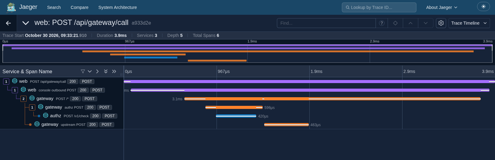

# Observability with Jaeger — capture a real AI tool-call trace

This walkthrough adds **Jaeger 2.22.0** to the local demo, generates real
distributed traces, and shows how to turn a trace waterfall into a LinkedIn
image. It uses the published OpenTelemetry-capable service images and the
existing demo credentials; no application build or AI-provider account is needed.



The example above is a real successful local demo request: **3 services,
6 spans, 3.9 ms**. Your timings will differ; this is an illustration of request
visibility, not a production performance benchmark.

## 1. What runs

```text
Web console → Gateway → Authorization service
                  └──→ Demo upstream API
       │           │            │
       └───────────┴────────────┘
                   OTLP/HTTP
                       ↓
             OpenTelemetry Collector
                 ├─ traces → Jaeger → browser waterfall
                 └─ metrics → Collector log summaries
```

The setup layers three Compose files:

| File | Purpose |
|---|---|
| [`demo/docker-compose.yml`](../demo/docker-compose.yml) | Existing application images, database, Redis, Dex and demo upstream. |
| [`demo/docker-compose.observability.yml`](../demo/docker-compose.observability.yml) | Enable service instrumentation and add the Collector. |
| [`demo/docker-compose.jaeger.yml`](../demo/docker-compose.jaeger.yml) | Add digest-pinned Jaeger and select the [Jaeger Collector configuration](../demo/otel-collector.jaeger.yaml). |

Only the Jaeger browser UI is published, at `127.0.0.1:16686`. Its OTLP
receiver stays on the internal Compose network. Jaeger uses **memory storage**:
export screenshots before restarting its container, because restarting it loses
the stored traces. Metrics remain in the Collector debug exporter; this setup
does not add a metrics dashboard.

## 2. Start the screenshot demo

Run the following from the **agent-gateway-demo repository root**. The usual
demo keys and licence must be present, as described in the [Quickstart](../README.md#quickstart).

Define this shell helper so every command uses the same overlays:

```sh
dc() {
  docker compose -f demo/docker-compose.yml \
    -f demo/docker-compose.observability.yml \
    -f demo/docker-compose.jaeger.yml "$@"
}
```

Point service telemetry at this local Collector, overriding any alternative
endpoint in your shell or `demo/.env`, then start the core services:

```sh
export OTEL_ENABLED=true
export OTEL_EXPORTER_OTLP_ENDPOINT=http://otel-collector:4318

dc up -d --wait postgres redis dex demoapi jaeger otel-collector
dc up -d --no-deps --wait authz tokensvc gateway web
```

The second command deliberately starts only the four application services: the
backing services are already running. You do not need the optional emotion MCP
server, FreeRide, external models or the other MCP gateways for these screenshots.
Use the same Compose project as your usual demo; the base file has fixed
container names, so two simultaneous copies would compete for names and ports.

Open:

* **Guided demo:** <http://localhost:8083/demo.html>
* **Jaeger:** <http://localhost:16686>

If port 16686 is occupied, set `JAEGER_UI_PORT=16687` in your shell before
starting and use that port instead. If Docker runs on a different machine from
your browser, forward the UI ports from your browser machine:

```sh
ssh -N -L 16686:127.0.0.1:16686 -L 8083:127.0.0.1:8083 user@docker-host
```

Then open the localhost URLs above on your browser machine. The demo's existing
Dex configuration supports the localhost console callback used by this flow.

## 3. Generate the best trace for your first image

On the **Guided demo** page, click these buttons in order and wait for each to
succeed:

1. **Run step 1** — sign in using the local demo SSO connector. It returns you
   to the guided demo with an authenticated console session.
2. **Run step 2** — create the scoped delegation.
3. **Run step 3** — mint the short-lived agent token.
4. **Run step 4** — execute the allowed €150 order.

Step 4 goes through the console, gateway, authorization service and real demo
upstream. It produces the clearest complete request waterfall. Allow about
**5–10 seconds** for the application and Collector batches to reach Jaeger.

If you prefer the terminal, run:

```sh
bash demo/protected-api-demo.sh
```

That exercises sign-in, token minting, allow, approval hold, approval, execution
and revocation. Its tool calls go directly to the gateway, so choose **gateway**
as the Jaeger service rather than expecting the extra console spans.

## 4. Find the trace in Jaeger

In the Jaeger **Search** page:

1. Select **Service → web**.
2. Select **Span Name → POST /api/gateway/call**. Older Jaeger UIs may call
   this field **Operation**.
3. Keep **Lookback → Last 1 hour** and click **Find Traces**.
4. Open a result titled **web: POST /api/gateway/call** with **6 spans**.
5. Keep **Trace Timeline** selected and expand the child-span tree if needed.

For the successful step-4 request you should see:

```text
web       POST /api/gateway/call
  web       console outbound POST
    gateway   POST /*
      gateway   authz POST
        authz     POST /v1/check
      gateway   upstream POST
```

The header reports **3 services** because the demo API itself has no server-side
OpenTelemetry instrumentation. Its network call is still visible as the gateway's
`upstream POST` client span. The authorization span measures the whole service
request; separate policy-engine, Redis and Postgres spans are not yet present.

## 5. Capture a clean image

1. Make the browser wide enough to read the service and span names. A desktop
   window around **1600 × 900** is a good starting point.
2. Click the **Toggle color mode** button in the top-right to choose dark mode
   if you prefer the look of the example.
3. Keep all six span rows visible and the timeline zoomed to the complete request.
4. Move the pointer off buttons and bars so no tooltip covers the image.
5. Capture the **trace title, duration/service/span counts and waterfall**.
   Crop away browser chrome and the empty area below the span rows.

Use macOS **Cmd+Shift+4**, Windows **Win+Shift+S**, or your Linux screenshot tool.
Save as PNG. The checked-in [example screenshot](../images/jaeger-trace-example.png)
is ready to use as a layout reference, or as the actual demo image.

### LinkedIn layout

For a simple landscape post, place the wide waterfall on a **1600 × 900** canvas
in Canva, Figma or PowerPoint, with a short headline above and three labels below.
Use a **1200 × 1500** portrait canvas for a carousel cover, followed by a second
slide with the larger waterfall so its labels remain readable on a phone.

Suggested wording:

> **One AI tool call. Every hop visible.**
>
> Enforce → Authorize → Execute
>
> OpenTelemetry tracing · Correlated logs · Trace-linked audit

Keep the actual service names and timings intact. A second image can show a
held or denied request without an upstream execution span: run guided steps
5–9 and select the corresponding trace. A policy denial is an expected outcome,
so it does not necessarily appear as a red infrastructure-error span.

Human approval, the later retry and token minting are **separate requests and
traces**. Do not label one waterfall as including the entire human approval
wait. Use the audit `approval_id` to relate those lifecycle events.

## 6. If no traces appear

```sh
dc ps
dc logs --since=5m jaeger otel-collector
dc logs --since=5m web gateway authz
```

* Generate a real request: `/healthz` is intentionally excluded from telemetry.
* Wait a few seconds and reload Jaeger's Search page so newly discovered service
  and span-name options are fetched.
* Confirm the successful demo step returned 200; an expired token or delegation
  can produce a shorter denied-request trace instead. Rerun steps 1–4 if needed.
* Use all three Compose files, in the order shown. The Jaeger overlay replaces
  the Collector configuration at the same mount path; it must be listed last.
* Ensure the application endpoint is `http://otel-collector:4318`, not
  `localhost:4318` inside an application container.
* Reapply environment or overlay changes with `dc up -d --no-deps authz tokensvc
  gateway web` and `dc up -d otel-collector jaeger`. Restarting a container alone
  does not change its Compose environment.
* Jaeger 2.22 uses `/api/v3/services` for its service API. An older diagnostic
  that calls `/api/services` can return 404 even while the UI is working.

## 7. Stop when you have your images

```sh
dc stop
```

This retains the demo database volumes. Jaeger's in-memory traces disappear
when its process stops; save your PNGs first. For general exporter settings,
sampling and managed-service configuration, see [Observability](Observability.md).
