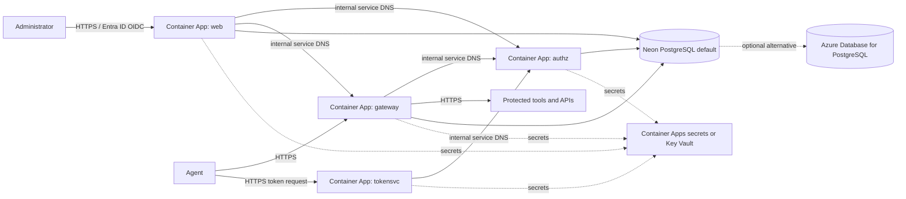

# Agent Gateway on Azure — proposed architecture

This is a low-cost, single-region proposal for running the existing
Agent Gateway service containers in a customer's Azure subscription. It is
not deployment automation and does not create resources.

## Proposed layout

Deploy `web`, `gateway`, `tokensvc`, and `authz` as separate Container Apps in
one **Consumption-plan** Container Apps environment:

| Service | Ingress | Low-cost default | Reliability option |
|---|---|---|---|
| `web` | External HTTPS | Minimum 0; scale to zero | Set minimum 1 and maximum 1 if reliable Entra ID OIDC sign-in is more important than idle cost. |
| `gateway` | External HTTPS | Minimum 0 | This is the policy enforcement point for agent requests. Scale-to-zero trades idle cost for cold-start latency. |
| `tokensvc` | External HTTPS | Minimum 0 | Restrict access to intended agent clients at the edge or with app authentication where appropriate. |
| `authz` | Internal only | Minimum 0 | Only the other Agent Gateway services should call the authorization API. Use the environment's generated internal service DNS name in `AUTHZ_URL`. |

Container Apps supports external and internal ingress, HTTPS, service
discovery, and scaling to zero. This avoids a separate load balancer for a
small deployment. Keep the public routes limited to the gateway, token
endpoint, and console; do not expose `authz` directly. The optional
`:8088` forward-proxy listener is not included: it needs separate TCP/proxy
routing and must not become an unrestricted public proxy.

### Web scale-to-zero and OIDC

The existing container web console keeps OIDC sign-in session state in
process memory. Scale-to-zero is supported by Azure Container Apps, but it
does not preserve that state: if the app scales down between the sign-in
request and identity-provider callback, the callback can reach a fresh
instance and fail state validation. A process restart has the same effect.
Keeping one replica warm reduces this risk but costs approximately $5.91/month
at the modeled idle rates; it does not make the session durable across a
restart.

The low-cost default therefore allows `web` to scale to zero and accepts
possible sign-in retries after idle periods. For a production console that
needs dependable sign-in, set `web` minimum and maximum replicas to one until
the application uses shared, durable OIDC session storage.

**Target design:** extend the web application to persist its short-lived
OIDC state/nonce and server-side sign-in session in the same Neon PostgreSQL
database, then configure the web service to use that shared session store.
The browser should continue to hold only the protected opaque session cookie.
With that code and image support, the web app can scale to zero and any
replica can complete the callback or resume a session. The current web image
does not provide this storage option: setting its existing `DATABASE_URL`
for Agent Gateway domain data does **not** make OIDC sessions persistent.
Until a release adds and documents shared session storage, keep one replica
warm when reliable console sign-in is required.

This differs from the other cloud implementations. The GCP branch sets the
Cloud Run web service to `min=0` and stores sessions and application state in
Firestore. The AWS branch uses an on-demand Web Lambda rather than a warm
container, with Cognito sign-in and DynamoDB-backed application state. Those
architectures do not require a continuously running web replica, but they are
not the same container session implementation as this Azure proposal.

Use the licensed published images from the current vendor release manifest,
pinning each image to its release tag or digest. Public Docker Hub pulls avoid
the fixed cost of a private Azure Container Registry for a small evaluation.
Mirror images to ACR for production supply-chain control if required; registry
storage and transfer are not included in the estimate.

## State and availability choices

### Default: Neon PostgreSQL

Use the existing Neon PostgreSQL database as the default durable-state
backend. Configure `PERSISTENCE=postgres` and `DATABASE_URL` for the
Agent Gateway services that use PostgreSQL. Use the Neon connection details
for the selected project, database, and role; require TLS, use the pooled
endpoint for runtime only after verifying compatibility with the current
Agent Gateway image, and keep connection limits in mind when Container Apps
scales out. The image's startup schema migration behavior must be validated
with the chosen Neon connection mode.

Neon is also the proposed low-cost backing store for shared web OIDC
sessions, but that requires a web application change and a release that
supports a session-storage configuration. It is not enabled merely by
setting `DATABASE_URL`. See [Web scale-to-zero and OIDC](#web-scale-to-zero-and-oidc).

The estimate treats the user's existing Neon plan as having no additional
database charge for this deployment. This is a user-specific assumption, not
a claim that Neon is free for all users or workloads. Check plan limits,
compute suspension/wakeup behavior, region, backup/retention, availability,
connection limits, and data-residency requirements. Cross-cloud network
latency and Azure data-egress charges are not modeled.

### Optional: Azure Database for PostgreSQL

Choose Azure Database for PostgreSQL Flexible Server only if a deployment
requires an Azure-managed database, private network integration, residency,
or a support/operations boundary that Neon does not satisfy. It is
provisioned compute, not a scale-to-zero database, and its cost is additional
to the Container Apps estimate. The pricing document shows small
non-production and illustrative production alternatives.

For production, choose a supported PostgreSQL tier and availability/backup
configuration for the audit-retention requirement. The Burstable tier is for
development, staging, and test workloads; Microsoft does not recommend it for
production. Configure a private network path from Container Apps to the
database, and validate the selected region, subnet, DNS, and firewall rules.
Those network and high-availability additions are not included in the
smallest-cost model.

## Azure service review

| Azure capability | Proposed use | Why / trade-off |
|---|---|---|
| Azure Container Apps Consumption | Run the four existing containers | Pay per use, supports zero minimum replicas, managed HTTPS ingress, internal service discovery, and HTTP-based scaling without operating Kubernetes. |
| Neon PostgreSQL | Default durable application state | Reuses the existing Neon account/database and avoids adding Azure database compute charges; introduces cross-cloud networking, plan-limit, and data-residency considerations. |
| Azure Database for PostgreSQL Flexible Server | Explicit alternative for Azure-managed state | Compatible with PostgreSQL persistence, but has provisioned hourly compute and storage charges. |
| Container Apps secrets; optionally Azure Key Vault | Provide JWT/admin secrets, customer key, and per-service licence files | Avoids committing secret material. For Key Vault, use managed identity and tightly scoped access; rotate/restart revisions when secret values change. |
| Microsoft Entra ID | OIDC identity provider for console sign-in | Fits the existing OIDC configuration. Configure the app registration's redirect URI to the web console's HTTPS URL and allowlist console administrators. |
| Azure Monitor / Log Analytics | Operational logs, metrics, and alerts | Useful for diagnosing scale-to-zero cold starts and database health. Ingestion and retention depend on volume and are excluded from the estimate. |
| Azure Container Registry | Optional private image mirror | Not required for public Docker Hub images; add for controlled image distribution, with extra storage and transfer charges. |

Azure Functions and Logic Apps are not the first choice for the existing
long-running HTTP services. Azure Kubernetes Service and Container Apps
Dedicated are also unnecessary for a low-cost pilot. Cosmos DB serverless is
not a drop-in replacement for the existing PostgreSQL persistence layer; it
would require an application storage adapter and migration work.

## Boundaries and operational caveats

- The estimate is for one Azure region (`francecentral`, Paris). It is not a
  multi-region or zone-redundant design.
- Container Apps ingress supplies managed HTTPS, but the proposal does not add
  Azure Front Door, Application Gateway/WAF, API Management, or DDoS
  Protection. Add the required edge and security controls for the deployment's
  threat model; these can materially increase cost.
- Route agent traffic to the Gateway PEP, not directly to protected upstreams.
  Permit only required egress and protect private upstream APIs from bypass
  routes.
- Keep JWT secrets identical across the services that validate the same
  tokens. Mount the matching customer private key and each service's signed
  licence token read-only at the paths expected by its image. Never place
  production activation material in Git.
- Scale-to-zero can add cold-start latency. The web console can scale to zero
  for lowest cost, but its in-memory OIDC state can make sign-in unreliable
  after idle periods. Set its minimum replica to one when reliability takes
  priority, or adopt shared durable session storage in the application.
- Validate the current image startup paths, health checks, mounted-secret
  filenames, OIDC callback behavior, and Container Apps resource limits with a
  non-production deployment before committing to this design.

## Microsoft references

- [Azure Container Apps overview](https://learn.microsoft.com/azure/container-apps/overview)
- [Ingress in Azure Container Apps](https://learn.microsoft.com/azure/container-apps/ingress-overview)
- [Scaling in Azure Container Apps](https://learn.microsoft.com/azure/container-apps/scale-app)
- [Manage Container Apps secrets](https://learn.microsoft.com/azure/container-apps/manage-secrets)
- [Azure Database for PostgreSQL compute options](https://learn.microsoft.com/azure/postgresql/compute-storage/concepts-compute)
- [Neon connection pooling](https://neon.com/docs/connect/connection-pooling)
- [Neon connection strings](https://neon.com/docs/connect/connect-from-any-app)
- [Azure Container Apps pricing](https://azure.microsoft.com/pricing/details/container-apps/)
- [Azure Database for PostgreSQL Flexible Server pricing](https://azure.microsoft.com/pricing/details/postgresql/flexible-server/)
