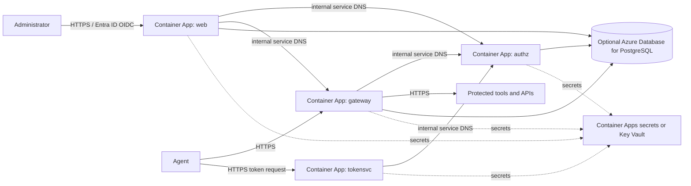

# Agent Gateway on Azure — proposed architecture

This is a low-cost, single-region proposal for running the existing
Agent Gateway service containers in a customer's Azure subscription. It is
not deployment automation and does not create resources.

## Proposed layout

Deploy `web`, `gateway`, `tokensvc`, and `authz` as separate Container Apps in
one **Consumption-plan** Container Apps environment:

| Service | Ingress | Scale recommendation | Notes |
|---|---|---|---|
| `web` | External HTTPS | Minimum 1, maximum 1 | Its OIDC sign-in session state is in memory; a single warm replica avoids scaling to zero between sign-in and callback. A restart can still lose an in-flight session. |
| `gateway` | External HTTPS | Minimum 0 | This is the policy enforcement point for agent requests. Scale-to-zero trades idle cost for cold-start latency. |
| `tokensvc` | External HTTPS | Minimum 0 | Restrict access to intended agent clients at the edge or with app authentication where appropriate. |
| `authz` | Internal only | Minimum 0 | Only the other Agent Gateway services should call the authorization API. Use the environment's generated internal service DNS name in `AUTHZ_URL`. |

Container Apps supports external and internal ingress, HTTPS, service
discovery, and scaling to zero. This avoids a separate load balancer for a
small deployment. Keep the public routes limited to the gateway, token
endpoint, and console; do not expose `authz` directly. The optional
`:8088` forward-proxy listener is not included: it needs separate TCP/proxy
routing and must not become an unrestricted public proxy.

Use the licensed published images from the current vendor release manifest,
pinning each image to its release tag or digest. Public Docker Hub pulls avoid
the fixed cost of a private Azure Container Registry for a small evaluation.
Mirror images to ACR for production supply-chain control if required; registry
storage and transfer are not included in the estimate.

## State and availability choices

### Lowest-cost evaluation

Set `PERSISTENCE=memory`, keep `authz` at one maximum replica, and omit
PostgreSQL and Redis. This avoids a continuously billed database, but
delegations, approvals, revocation state, and audit records are ephemeral and
can be lost on restart or scale-to-zero. Do not use this option where audit
retention or reliable multi-replica operation is required.

### Durable state

Set `PERSISTENCE=postgres` and use Azure Database for PostgreSQL Flexible
Server. The estimate prices a small non-HA Burstable server for development or
staging and separately shows a General Purpose production baseline. PostgreSQL
Flexible Server is provisioned compute, not a scale-to-zero database; it adds
a monthly floor even when the Container Apps have no traffic.

Redis is optional in the current deployment guide and is omitted to minimize
cost. Without Redis, revocation and decision-cache behavior has the
documented database fallback and may have different latency. Add a managed
Redis service only if measured revocation/latency requirements justify its
additional always-on cost.

For production, choose a supported PostgreSQL tier and availability/backup
configuration for the audit-retention requirement. The Burstable tier is for
development, staging, and test workloads; Microsoft does not recommend it for
production. Configure a private network path from Container Apps to the
database, and validate the selected region, subnet, DNS, and firewall rules.
Those network and high-availability additions are not included in the
smallest-cost model.

## Azure service review

| Azure capability | Proposed use | Why / trade-off |
|---|---|---|
| Azure Container Apps Consumption | Run the four existing containers | Pay per use, supports zero minimum replicas, managed HTTPS ingress, internal service discovery, and HTTP-based scaling without operating Kubernetes. |
| Azure Database for PostgreSQL Flexible Server | Optional durable application state | Compatible with the existing PostgreSQL persistence mode, but has a provisioned hourly compute and storage charge. |
| Container Apps secrets; optionally Azure Key Vault | Provide JWT/admin secrets, customer key, and per-service licence files | Avoids committing secret material. For Key Vault, use managed identity and tightly scoped access; rotate/restart revisions when secret values change. |
| Microsoft Entra ID | OIDC identity provider for console sign-in | Fits the existing OIDC configuration. Configure the app registration's redirect URI to the web console's HTTPS URL and allowlist console administrators. |
| Azure Monitor / Log Analytics | Operational logs, metrics, and alerts | Useful for diagnosing scale-to-zero cold starts and database health. Ingestion and retention depend on volume and are excluded from the estimate. |
| Azure Container Registry | Optional private image mirror | Not required for public Docker Hub images; add for controlled image distribution, with extra storage and transfer charges. |

Azure Functions and Logic Apps are not the first choice for the existing
long-running HTTP services. Azure Kubernetes Service and Container Apps
Dedicated are also unnecessary for a low-cost pilot. Cosmos DB serverless is
not a drop-in replacement for the existing PostgreSQL persistence layer; it
would require an application storage adapter and migration work.

## Boundaries and operational caveats

- The estimate is for one Azure region (`francecentral`, Paris). It is not a
  multi-region or zone-redundant design.
- Container Apps ingress supplies managed HTTPS, but the proposal does not add
  Azure Front Door, Application Gateway/WAF, API Management, or DDoS
  Protection. Add the required edge and security controls for the deployment's
  threat model; these can materially increase cost.
- Route agent traffic to the Gateway PEP, not directly to protected upstreams.
  Permit only required egress and protect private upstream APIs from bypass
  routes.
- Keep JWT secrets identical across the services that validate the same
  tokens. Mount the matching customer private key and each service's signed
  licence token read-only at the paths expected by its image. Never place
  production activation material in Git.
- Scale-to-zero can add cold-start latency. The web console remains at one
  replica because its sign-in flow uses in-memory session state.
- Validate the current image startup paths, health checks, mounted-secret
  filenames, OIDC callback behavior, and Container Apps resource limits with a
  non-production deployment before committing to this design.

## Microsoft references

- [Azure Container Apps overview](https://learn.microsoft.com/azure/container-apps/overview)
- [Ingress in Azure Container Apps](https://learn.microsoft.com/azure/container-apps/ingress-overview)
- [Scaling in Azure Container Apps](https://learn.microsoft.com/azure/container-apps/scale-app)
- [Manage Container Apps secrets](https://learn.microsoft.com/azure/container-apps/manage-secrets)
- [Azure Database for PostgreSQL compute options](https://learn.microsoft.com/azure/postgresql/compute-storage/concepts-compute)
- [Azure Container Apps pricing](https://azure.microsoft.com/pricing/details/container-apps/)
- [Azure Database for PostgreSQL Flexible Server pricing](https://azure.microsoft.com/pricing/details/postgresql/flexible-server/)
