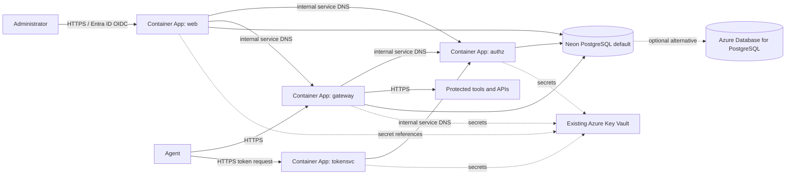
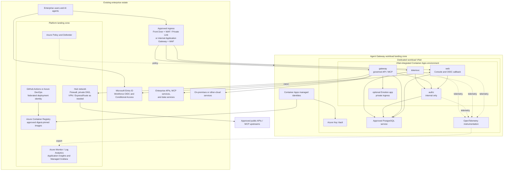

# Agent Gateway on Azure — proposed architecture

> This design is implemented by the public Azure Bicep template and lifecycle
> wrapper, but no new Azure deployment has yet been run with that tooling and
> the design is not production-certified. The supervised development trial was
> torn down; its purge-protected Key Vault remains soft-deleted. Neon and Entra
> were outside that teardown. See the [trial status](trial-status.md) and
> [deployment guide](../Azure-Deployment-Guide.md).

This is the low-cost, single-region deployment design for running licensed,
prebuilt Agent Gateway service images in a customer's Azure subscription.
The deployment wrapper deploys the resources described here; the application
source and image build files remain proprietary and are not in this repo.

## Proposed layout

Deploy `web`, `gateway`, `tokensvc`, and `authz` as separate Container Apps in
one **Consumption-plan** Container Apps environment:

| Service | Ingress | Low-cost default | Reliability option |
|---|---|---|---|
| `web` | External HTTPS | Minimum 1, maximum 2 | Keep a warm replica pending deployed Azure OIDC cold-callback and restart acceptance. |
| `gateway` | External HTTPS | Minimum 0, maximum 2 | This is the policy enforcement point for agent requests. Scale-to-zero trades idle cost for cold-start latency. |
| `tokensvc` | External HTTPS | Minimum 0, maximum 2 | Restrict access to intended agent clients at the edge or with app authentication where appropriate. |
| `authz` | Internal only | Minimum 1, maximum 2 | Only the other Agent Gateway services should call the authorization API. Use the environment's generated internal service DNS name in `AUTHZ_URL`. |

Container Apps supports external and internal ingress, HTTPS, service
discovery, and scaling to zero. This avoids a separate load balancer for a
small deployment. Keep the public routes limited to the gateway, token
endpoint, and console; do not expose `authz` directly. The optional
`:8088` forward-proxy listener is not included: it needs separate TCP/proxy
routing and must not become an unrestricted public proxy.

### Web scale-to-zero and OIDC

The trial application used PostgreSQL-backed shared OIDC/session state, and
local cross-instance tests passed. The operator also confirmed interactive
Entra sign-in during the trial. A full Azure cold-callback test across
scale-down/scale-to-zero was not completed, so the trial kept `web` at one
minimum replica. For a new environment, keep that minimum until the exact
deployed image passes cold-callback and restart acceptance. Durable database
state is necessary but does not, by itself, prove scale-to-zero behavior.

This differs from the other cloud implementations. The GCP branch sets the
Cloud Run web service to `min=0` and stores sessions and application state in
Firestore. The AWS branch uses an on-demand Web Lambda rather than a warm
container, with Cognito sign-in and DynamoDB-backed application state. Those
architectures do not require a continuously running web replica, but they are
not the same container session implementation as this Azure proposal.

Use licensed, prebuilt images from the release owner's manifest and pin each
service to its immutable digest. This repository does not provide application
source or build instructions, and users cannot rebuild these images. The
installer supports an optional Key Vault-backed private-registry credential
for the four service images. Registry storage and transfer are not included
in the cost estimate.

## State and availability choices

### Default: Neon PostgreSQL

Use Neon PostgreSQL as the default durable-state backend. Configure
`PERSISTENCE=postgres` and `DATABASE_URL` only for Agent Gateway services whose
release contract requires PostgreSQL. Use a dedicated least-privilege role for
each database consumer; keep web OIDC/session tables in a separate schema and
grant the web session role access only to that schema. Require TLS, use a
direct endpoint for schema migrations, and use a pooled runtime endpoint only
after verifying compatibility with the selected image. Keep connection limits
in mind when Container Apps scales out. Startup migration behavior and
concurrent replica safety must be validated with the selected connection mode.

Neon is also the proposed low-cost backing store for shared web OIDC
transactions and sessions, but that requires a web application change and a
release that supports a session-storage configuration. It is not enabled
merely by setting `DATABASE_URL`. Database failure must fail closed for
callback state validation and authenticated session access; it must not fall
back to process-local sessions. See
[Web scale-to-zero and OIDC](#web-scale-to-zero-and-oidc).

The runtime repo includes the Neon project helper and an Azure deployment
wrapper. The wrapper consumes an existing Neon credential file and does not
provision or delete Neon resources. Existing Neon projects are not deleted by
the helper or Azure teardown.

The estimate treats the user's existing Neon plan as having no additional
database charge for this deployment. This is a user-specific assumption, not
a claim that Neon is free for all users or workloads. Check plan limits,
compute suspension/wakeup behavior, region, backup/retention, availability,
connection limits, and data-residency requirements. Cross-cloud network
latency and Azure data-egress charges are not modeled.

### Optional: Azure Database for PostgreSQL

Choose Azure Database for PostgreSQL Flexible Server only if a deployment
requires an Azure-managed database, private network integration, residency,
or a support/operations boundary that Neon does not satisfy. It is
provisioned compute, not a scale-to-zero database, and its cost is additional
to the Container Apps estimate. The pricing document shows small
non-production and illustrative production alternatives.

For production, choose a supported PostgreSQL tier and availability/backup
configuration for the audit-retention requirement. The Burstable tier is for
development, staging, and test workloads; Microsoft does not recommend it for
production. Configure a private network path from Container Apps to the
database, and validate the selected region, subnet, DNS, and firewall rules.
Those network and high-availability additions are not included in the
smallest-cost model.

## Azure service review

| Azure capability | Proposed use | Why / trade-off |
|---|---|---|
| Azure Container Apps Consumption | Run the four existing containers | Pay per use, supports zero minimum replicas, managed HTTPS ingress, internal service discovery, and HTTP-based scaling without operating Kubernetes. |
| Neon PostgreSQL | Default durable application state | Reuses the existing Neon account/database and avoids adding Azure database compute charges; introduces cross-cloud networking, plan-limit, and data-residency considerations. |
| Azure Database for PostgreSQL Flexible Server | Explicit alternative for Azure-managed state | Compatible with PostgreSQL persistence, but has provisioned hourly compute and storage charges. |
| Existing Azure Key Vault | Provide PostgreSQL, OIDC, licence, JWT/admin, and optional registry secrets through managed-identity references | The installer does not create the vault. New secrets are deployment-tagged for teardown; pre-existing secrets are preserved. |
| Microsoft Entra ID | OIDC identity provider for console sign-in | Fits the existing OIDC configuration. Configure the app registration's redirect URI to the web console's HTTPS URL and allowlist console administrators. |
| Azure Monitor / Log Analytics | Operational logs, metrics, and alerts | Useful for diagnosing scale-to-zero cold starts and database health. Ingestion and retention depend on volume and are excluded from the estimate. |
| Container image registry | Pull release-owner images by immutable digest | Public images require no registry secret. The installer can use a Key Vault-backed credential for private service images; private registry fees are additional. |

Azure Functions and Logic Apps are not the first choice for the existing
long-running HTTP services. Azure Kubernetes Service and Container Apps
Dedicated are also unnecessary for a low-cost pilot. Cosmos DB serverless is
not a drop-in replacement for the existing PostgreSQL persistence layer; it
would require an application storage adapter and migration work.

## Boundaries and operational caveats

- The estimate is for one Azure region (`francecentral`, Paris). It is not a
  multi-region or zone-redundant design.
- Container Apps ingress supplies managed HTTPS, but the proposal does not add
  Azure Front Door, Application Gateway/WAF, API Management, or DDoS
  Protection. Add the required edge and security controls for the deployment's
  threat model; these can materially increase cost.
- Route agent traffic to the Gateway PEP, not directly to protected upstreams.
  Permit only required egress and protect private upstream APIs from bypass
  routes.
- Keep JWT secrets identical across the services that validate the same
  tokens. The installer references the database URL, OIDC secret, licence
  token, and JWT/admin secrets from Key Vault; never place production
  activation material in Git.
- Scale-to-zero can add cold-start latency. Do not set the web console's
  minimum replicas to zero until Neon-backed OIDC state/session storage is
  implemented and cold-callback behavior passes acceptance testing. Until then
  keep its minimum at one; a warm instance still does not protect against
  process restart.
- Validate the current image startup paths, health checks, mounted-secret
  filenames, OIDC callback behavior, and Container Apps resource limits with a
  non-production deployment before committing to this design.

## Proposed integration with an existing enterprise estate

This is a target proposal, not the topology used for the development trial.
It follows Azure landing-zone separation: shared identity, network,
governance, and operations remain in the enterprise platform landing zone;
Agent Gateway runs in a dedicated workload landing zone or subscription.

### Enterprise integration boundaries

- Use the customer's existing landing zone, management groups, policy
  assignments, identity controls, and security services; do not recreate
  shared platform resources for the application.
- Select one ingress path. Keep `authz` private and ensure protected requests
  cannot bypass Gateway policy enforcement. The trial used public ingress and
  did not implement this private enterprise network topology.
- Design the VNet-integrated Container Apps environment, delegated subnet,
  DNS, UDRs, firewall, private endpoints, and egress policy before
  provisioning. Several networking choices are fixed at environment creation.
- Route the Gateway only to approved upstream destinations. Use the existing
  hybrid routes for private enterprise services and controlled egress for
  public APIs.
- Use an enterprise-approved PostgreSQL service and identity/role model.
  The trial used Neon over TLS; this repo does not provision either database
  choice or its network path.
- Send traces, metrics, and logs to approved Azure Monitor, Application
  Insights, Log Analytics, or Managed Grafana destinations. OpenTelemetry
  export and production monitoring need independent verification.
- Build and promote immutable image digests through the enterprise pipeline
  and registry. The trial used Docker Hub; it did not establish a production
  release pipeline.

## Microsoft references

- [Azure Container Apps overview](https://learn.microsoft.com/azure/container-apps/overview)
- [Ingress in Azure Container Apps](https://learn.microsoft.com/azure/container-apps/ingress-overview)
- [Scaling in Azure Container Apps](https://learn.microsoft.com/azure/container-apps/scale-app)
- [Manage Container Apps secrets](https://learn.microsoft.com/azure/container-apps/manage-secrets)
- [Azure Database for PostgreSQL compute options](https://learn.microsoft.com/azure/postgresql/compute-storage/concepts-compute)
- [Neon connection pooling](https://neon.com/docs/connect/connection-pooling)
- [Neon connection strings](https://neon.com/docs/connect/connect-from-any-app)
- [Azure Container Apps pricing](https://azure.microsoft.com/pricing/details/container-apps/)
- [Azure Database for PostgreSQL Flexible Server pricing](https://azure.microsoft.com/pricing/details/postgresql/flexible-server/)
