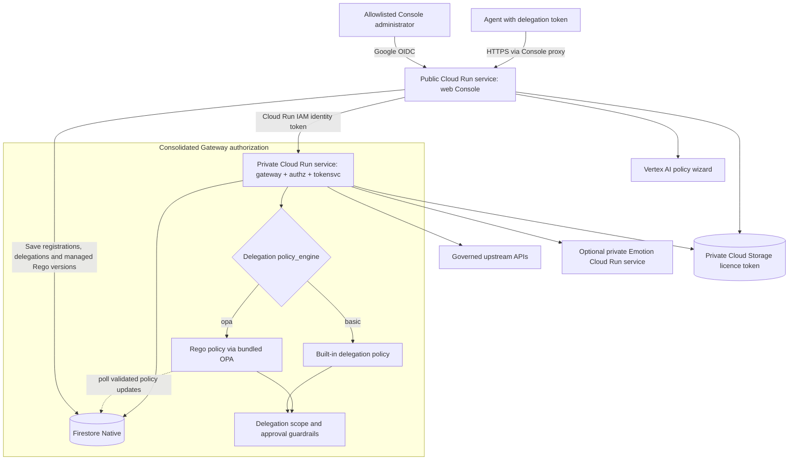
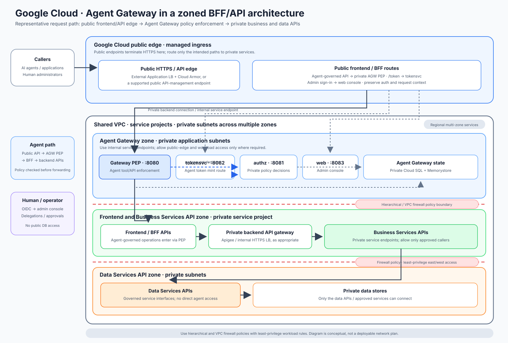

# GCP customer deployment architecture

The runtime deployment script provisions a single-region control plane in Google Cloud Run. The default region is Paris (`europe-west9`). This describes the resources created by `scripts/deploy-gcp.sh`; it is not an inventory of any particular Google Cloud project.

## Proposed integration with an existing enterprise estate

The diagram proposes **one way to place Agent Gateway in an existing Google
Cloud estate**: retain the customer's public frontend/BFF entry and private
Business Services and Data Services APIs, and route agent-governed operations
through the gateway PEP. It is an illustrative integration pattern, not a
required topology. The customer decides whether and how to adapt it.

The diagram shows logical component roles and trust boundaries, not a
resource-for-resource picture of the default GCP deployment. This branch's
script deploys the serverless control plane into one selected Google Cloud
project and region (the default is Paris, `europe-west9`). It creates Cloud
Run services and application state, but does not provision the customer's
Shared VPC, enterprise firewall policies, frontend/BFF, or private ingress
to backend APIs. Fitting the deployment into an existing estate requires
customer-specific changes to deployment scripts/IaC, IAM, routing, and
network access.

For example, the customer's public API edge may route only agent-governed
requests to the Agent Gateway endpoint, while ordinary user traffic retains
its existing route. If a protected backend must remain private, configure
and validate the required Cloud Run ingress/egress and private service path;
do not assume that Shared VPC or firewall boundaries are created by the
default deployment. Keep a route through the PEP for every operation
requiring its own policy decision; BFF fan-out is not evaluated separately
unless each downstream call is routed through a PEP.

“Zones” in the diagram are logical trust boundaries. Implement them using
the customer's actual routing and hierarchical/VPC firewall policies. The
diagram does not require the customer to replace existing API management or
firewall products.

For Google Cloud design background, see the
[landing zone design overview](https://cloud.google.com/architecture/landing-zones),
[external Application Load Balancer](https://cloud.google.com/load-balancing/docs/https),
[internal Application Load Balancer](https://cloud.google.com/load-balancing/docs/l7-internal),
and [VPC firewall guidance](https://cloud.google.com/vpc/docs/firewalls).

## Core resources

- **Cloud Run:** `web` is publicly reachable for the console; `gateway` requires Cloud Run IAM authentication. The gateway embeds the `authz` and `tokensvc` functions. Both services use 1 vCPU, 512 MiB memory, concurrency 80, and scale from zero by default (`min=0`). The web service is capped at one instance and the gateway at ten.
- **Image registry:** the script pulls `agent-gateway-*_g` images from the Docker Hub namespace configured in the ignored `gcp-config.env` file, then mirrors the gateway and web images into a regional Artifact Registry repository in the customer project. Deployments can use immutable release tags or the moving `latest` alias.
- **Licence activation:** a signed vendor licence token is stored in a private Cloud Storage bucket. The core service launchers fetch the configured token generation, verify its RSA-PSS signature and expiry, then start the unencrypted service binary. The customer private key is not used by these four services.
- **Secrets:** Secret Manager stores the gateway JWT secret and admin token. If Google OIDC is configured, its client secret is stored there too.
- **State:** Firestore Native `(default)` stores customer-registered upstream routes, sessions, delegations, approvals, audit state, security/replay state, and the managed Rego policy with its rollback history. The deploy script creates the database and required composite indexes.
- **Vertex AI:** the web service account receives `roles/aiplatform.user` for the policy wizard.
- **Optional Emotion backend:** `--emotion` deploys a separate private Cloud Run service. It uses the model image's bundled vendor public key and signed token; the Agent Gateway customer private key is neither required nor uploaded.

## Request and identity flow

Allowlisted administrators sign in to the public Console with Google OIDC. The
Console's delegation wizard can save either the built-in policy or Rego (OPA)
as the new delegation's `policy_engine` in Firestore. The editor saves
validated policy versions and rollback history in Firestore; Gateway instances
poll for updates and retain their last valid policy if a change cannot be
loaded. One active Rego policy is shared by all delegations selecting OPA.
Agents send delegated
requests to the public Console endpoint, which proxies them to the private
Gateway using a Google-signed Cloud Run identity token. The Gateway checks the
token audience and caller identity before accepting internal calls, then uses
the engine recorded on the delegation. The selected engine does not bypass
delegation scope or mandatory approval checks. The initial Rego policy and OPA
runtime are bundled in the Gateway image; they are not a separate Cloud Run
service.

The Gateway keeps the Open-Meteo weather upstream in `UPSTREAM_URL`, routes
`/api-geocoding` to `UPSTREAM_GEOCODING_URL`, and routes `/api-users` and
simulated `/api-refunds` to `UPSTREAM_DEMO_API_URL`. The optional Emotion MCP
service is configured separately as `UPSTREAM_MCP_URL`. Cloud Run provides
HTTPS endpoints and service-to-service IAM enforcement. For a customer-registered
API or MCP server, the web service and Gateway use the shared Firestore
catalog to route the governed path to the configured existing upstream.
Registration does not deploy the upstream or provide a general egress proxy.

## Availability and operational trade-offs

Both core services use `min=0` to avoid baseline instance charges. Cloud Run can scale them to zero during idle periods, so the first request after inactivity may have a cold-start delay. Startup includes retrieving and verifying the signed licence token; image decryption is not performed.

The deployment is single-region and does not configure cross-region failover. Firestore is created in the selected region. The optional Emotion service also scales on demand and may have additional model initialization time. If cold starts affect users, set `--min=1` on both core `gcloud run deploy` commands in `scripts/deploy-gcp.sh` and redeploy.

## Related documentation

See the [customer deployment guide](../GCP-Deployment-Guide.md) and [pricing estimate](serverless-pricing.md). For the source-build and Terraform workflow, see the [GCP source repository documentation](https://github.com/stevef1uk/agent-gateway/tree/gcp/docs/gcp).
