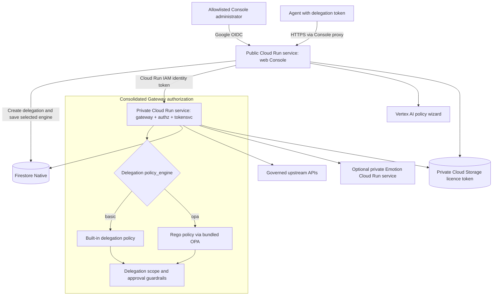

# GCP customer deployment architecture

The runtime deployment script provisions a single-region control plane in Google Cloud Run. The default region is Paris (`europe-west9`). This describes the resources created by `scripts/deploy-gcp.sh`; it is not an inventory of any particular Google Cloud project.

## Core resources

- **Cloud Run:** `web` is publicly reachable for the console; `gateway` requires Cloud Run IAM authentication. The gateway embeds the `authz` and `tokensvc` functions. Both services use 1 vCPU, 512 MiB memory, concurrency 80, and scale from zero by default (`min=0`). The web service is capped at one instance and the gateway at ten.
- **Image registry:** the script pulls `stevef1uk/agent-gateway-*_g` images from Docker Hub and mirrors the gateway and web images into a regional Artifact Registry repository in the customer project. Deployments can use immutable release tags or the moving `latest` alias.
- **Licence activation:** a signed vendor licence token is stored in a private Cloud Storage bucket. The core service launchers fetch the configured token generation, verify its RSA-PSS signature and expiry, then start the unencrypted service binary. The customer private key is not used by these four services.
- **Secrets:** Secret Manager stores the gateway JWT secret and admin token. If Google OIDC is configured, its client secret is stored there too.
- **State:** Firestore Native `(default)` stores sessions, delegations, approvals, audit state, and security/replay state. The deploy script creates the database and required composite indexes.
- **Vertex AI:** the web service account receives `roles/aiplatform.user` for the policy wizard.
- **Optional Emotion backend:** `--emotion` deploys a separate private Cloud Run service. It uses the model image's bundled vendor public key and signed token; the Agent Gateway customer private key is neither required nor uploaded.

## Request and identity flow

Allowlisted administrators sign in to the public Console with Google OIDC. The
Console's delegation wizard can save either the built-in policy or Rego (OPA)
as the new delegation's `policy_engine` in Firestore. Agents send delegated
requests to the public Console endpoint, which proxies them to the private
Gateway using a Google-signed Cloud Run identity token. The Gateway checks the
token audience and caller identity before accepting internal calls, then uses
the engine recorded on the delegation. The selected engine does not bypass
delegation scope or mandatory approval checks. The Rego policy and OPA runtime
are bundled in the Gateway image; they are not a separate Cloud Run service.

The Gateway keeps the Open-Meteo weather upstream in `UPSTREAM_URL`, routes
`/api-geocoding` to `UPSTREAM_GEOCODING_URL`, and routes `/api-users` and
simulated `/api-refunds` to `UPSTREAM_DEMO_API_URL`. The optional Emotion MCP
service is configured separately as `UPSTREAM_MCP_URL`. Cloud Run provides
HTTPS endpoints and service-to-service IAM enforcement.

## Availability and operational trade-offs

Both core services use `min=0` to avoid baseline instance charges. Cloud Run can scale them to zero during idle periods, so the first request after inactivity may have a cold-start delay. Startup includes retrieving and verifying the signed licence token; image decryption is not performed.

The deployment is single-region and does not configure cross-region failover. Firestore is created in the selected region. The optional Emotion service also scales on demand and may have additional model initialization time. If cold starts affect users, set `--min=1` on both core `gcloud run deploy` commands in `scripts/deploy-gcp.sh` and redeploy.

## Related documentation

See the [customer deployment guide](../GCP-Deployment-Guide.md) and [pricing estimate](serverless-pricing.md). For the source-build and Terraform workflow, see the [GCP source repository documentation](https://github.com/stevef1uk/agent-gateway/tree/gcp/docs/gcp).
